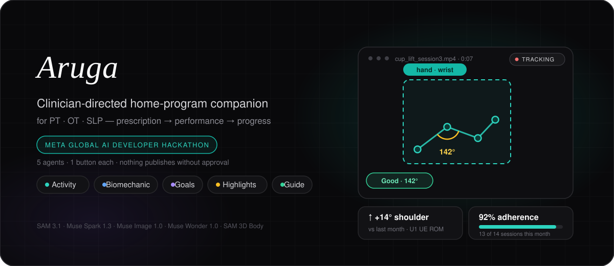
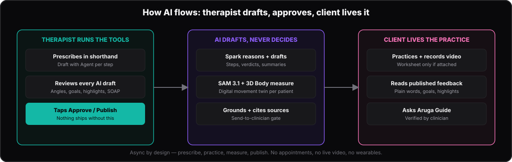
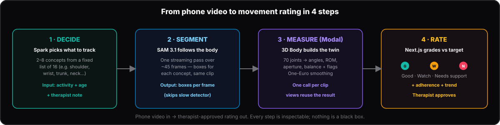

<p align="center">
  
</p>

<h1 align="center">Aruga</h1>
<p align="center"><b>Clinician-directed home-program companion for Physical Therapy, Occupational Therapy, and Speech-Language Pathology</b></p>

<p align="center">Built for the <b>Meta Global AI Developer Hackathon</b> — <b>Build for Your World</b></p>

<p align="center">
  
  
  
  
  
</p>

<p align="center">
  <a href="#about-aruga">About</a> ·
  <a href="#who-uses-it">Who uses it</a> ·
  <a href="#the-5-agents">Agents</a> ·
  <a href="#use-of-modal">Biomech backend</a> ·
  <a href="#describe-your-use-of-meta-products">Meta products</a> ·
  <a href="#why-are-metas-models-important-to-your-solution">Why Meta</a> ·
  <a href="#run-it">Run it</a> ·
  <a href="docs/AGENTS_GUIDE.md">Agents guide</a>
</p>

> ⚠️ **Important:** Aruga does not replace therapy — it cannot diagnose, treat, or give medical advice. It only measures movement, drafts materials, and organizes the home program; a licensed therapist reviews and approves everything.

---

## About Aruga

**Aruga** (Filipino: *to take care of, to nurture*) is a **clinician-directed home-program companion** for PT, OT, and SLP that makes the home half of rehabilitation **visible, measurable, and personal** — bringing the clinic's eyes into real life, where recovery actually happens. It is **asynchronous by design** — no appointments, no live video, no wearables. Everything is store-and-forward.

The name is the idea. In Filipino, *aruga* is what a caregiver does — staying close, guiding the hands, watching the small reps no one else sees. That's the gap Aruga fills: clinic gains fade unless they survive real life, but most practice happens alone and unseen. **Unobserved practice silently fails 50–65% of the time**<sup>[1](#studies-cited)</sup> — not for lack of effort, but **invisibility**.

The loop is simple: the therapist writes shorthand, Aruga turns it into clear steps (worksheet optional), and the client records a short video per step. That video becomes **evidence** — measured for angles, ROM, and compensation, never diagnosis.

**Four agents prep, two help assess.** Activity, Biomechanic, Goal Tracking, and Highlights each draft one thing — steps, movement ratings, goal checks, monthly bests. Aruga Guide and the drafting helpers then help the therapist assess and explain. **Every output is a draft — nothing reaches a patient until the therapist taps Approve or Publish.** Aruga never treats, diagnoses, or advises.

### Quick glossary

| Term | What it means |
|---|---|
| **Home program** | Exercises a therapist prescribes for practice between clinic visits, with a schedule and per-step instructions |
| **OT (Occupational Therapy)** | Therapy for daily activities: grasp, self-care, dressing, feeding, handwriting, returning to routines |
| **PT (Physical Therapy)** | Therapy for movement: strength, balance, gait, transfers, getting around safely |
| **SLP (Speech-Language Pathology)** | Therapy for communication, speech, language, and swallowing |
| **STG / LTG** | Short-term and long-term goals set with the therapist — small milestones vs big outcomes |
| **SOAP note** | The therapist's chart: Subjective (what the client reports), Objective (what was measured), Assessment (clinical read), Plan (what's next) |
| **ROM** | Range of motion — how far a joint moves, measured here in degrees from phone video |
| **Compensation / flag** | A workaround the body uses (e.g. leaning the trunk because the shoulder is weak) — Aruga flags it so the therapist can cue it |
| **Movement twin** | A per-patient digital twin of how someone moves, rebuilt from each video — used to review progress, never to diagnose |
| **Draft** | Anything AI produces in Aruga — always needs therapist Approve / Publish before a client sees it |
| **Adherence** | How much of the prescribed program was actually done, and how well — measured, not self-reported |

---

## Describe your use of Meta products

Every runtime model call runs through the Meta Model API; open weights run on Modal and Baseten.

| Meta product | Exactly what we use it for |
|---|---|
| **Muse Spark 1.3** | Reasoning core of all five agents — activity drafts, biomech concept planning, 7-signal goal verdicts, best-7 highlights, SOAP drafts, family summaries. Strict `json_schema` outputs, `reasoning:medium/high`, prompt caching, multi-turn `previous_response_id` chains |
| **Responses API + built-in tools** | One agentic loop per agent (`parallel_tool_calls`, cached prompts); server-side `web_search` grounds Aruga Guide answers with citations |
| **Muse Spark 1.2-contributor + Muse Wonder 1.0** | Selectable chat models in Aruga Guide; Wonder reserved for max-reasoning escalation |
| **Muse Image 1.0** | Printable line-art worksheets per patient from the agent's visual brief (toggleable per step) |
| **SAM 3.1** | Temporal segmentation of 2–8 body concepts per clip via streaming Responses + `@meta-sam/parser`; one pass regardless of concept count |

### Open weights via partners

| Partner | Exactly what runs there |
|---|---|
| **SAM 3D Body via Modal** | Open-weights 3D pose model on a Modal volume + endpoint for joint angles and ROM — it builds each patient's **digital movement twin** used for simulation and review. Same container on CPU today, ~10× faster on GPU. |
| **Muse Spark Open via Baseten** | Open-weights model for prototyping prompts, auditing code, and testing ideas before anything ships. Dev loop only — runtime patient features stay on the Meta Model API. |

## Why are Meta's models important to your solution?

Home rehab fails on two halves: nobody can *see* the practice, and nobody has time to *reason* over it. Meta is the stack that covers both halves behind one API — remove any piece and the loop breaks back into invisible practice.

| Pillar | What Meta's models do | Why it matters |
|---|---|---|
| **Seeing** | SAM 3.1 tracks the body through ordinary phone video — no wearables or clinic hardware — and the open-weights 3D Body model turns those tracks into a per-patient **digital movement twin for simulation**: joint angles and ROM, rebuilt from every submission | Non-adherence hits 50–65% (up to 70% in low-back-pain cohorts)<sup>[1](#studies-cited)</sup>; diaries are unreliable (≈35% truly adherent)<sup>[2](#studies-cited)</sup><sup>[3](#studies-cited)</sup>, while phone markerless tracking validates at ±4–6°<sup>[4](#studies-cited)</sup> — video proof replaces the diary |
| **Reasoning** | Spark runs each agent's loop: read the evidence, reason at the right effort (`reasoning:medium/high`, Wonder escalation), emit a strict `json_schema` draft — Goal Tracking chunks goals 5 at a time with cross-turn context, Biomechanic plans concepts before measuring, Highlights weighs 7 signals | Prompt caching makes hundreds of reviewable drafts affordable per clinic — a formatting lottery becomes a reliable pipeline |
| **Grounding** | Biomechanic ratings are computed from measured twin numbers vs per-activity targets, with evidence timestamps to rewatch; Guide answers cite the client's own data plus web search, gated by *Send to clinician* | Every claim points at something real — the difference between a health chatbot and a clinical companion |
| **Turnaround** | SAM segments in one streaming pass; 3D Body resolves a 30s clip in ~90–130s on a small Modal CPU (warm runs much faster, ~10× on GPU); cached Spark drafts instantly | Measurement and judgment land inside the therapist's async review window — tele-assessment on a mid-range phone |
| **Fit** | Models accept exactly one submitted video, reviewed later — no live streaming, sensors, or appointments | The models fit async, phone-first care instead of forcing care to fit the tech |

One line per product: SAM sees, Spark reasons, Image illustrates, open weights build the twin.

### Studies cited

1. Physiopedia. (n.d.). *Adherence to home exercise programs*. https://www.physio-pedia.com/Adherence_to_Home_Exercise_Programs
2. Yalew, E. S., Melese, A. Z., Guadie, Y. G., & Gashaw, M. (2022). Adherence to home-based exercise program and its predictors among patients treated in physiotherapy outpatient department in Amhara Region hospitals in Ethiopia: A prospective cross-sectional study. *Patient Preference and Adherence*, *16*, 561–572.
3. Argent, R., Daly, A., & Caulfield, B. (2018). Patient involvement with home-based exercise programs: Can connected health interventions influence adherence? *JMIR mHealth and uHealth*, *6*(3), e47. https://doi.org/10.2196/mhealth.8518
4. Validation of OpenCap: A low-cost markerless motion capture system for lower-extremity kinematics during return-to-sport tasks. (2024). *Journal of Biomechanics*. Two smartphones vs. 10-camera Vicon: grand mean error 3.85° MAE / 4.34° RMSE; knee-osteoarthritis patient validation ≈ 6° RMSE. https://www.sciencedirect.com/science/article/abs/pii/S0021929024002781

---

## Who uses it

- **Therapist** — the one in charge. She manages her caseload, writes home programs in shorthand, and lets the agents draft the rest: steps, worksheets, SOAP notes, movement ratings. She reviews client videos, taps Approve or Publish, and sends care guides. Nothing reaches a client without her.
- **Client (+ caregiver)** — the one doing the work. They open their program, follow the steps, color the sheet if one was attached, and record a short video per step with a quick note. Later they read their therapist's published feedback, see their goal progress and monthly highlights, and get a plain-words family summary. A caregiver can help record, read, and practice alongside.

## The 5 agents

| Agent | Who uses it | What it does | What happens next |
|---|---|---|---|
| **Activity** | Therapist creates, client completes | Turns shorthand into clear steps, plus an optional custom worksheet (line art) for that one patient | Therapist attaches, edits, or regenerates; client colors or prints only if one is attached |
| **Biomechanic** | Therapist runs, client reads the result | Measures joint angles, ROM, and compensation flags from a short phone video | Each metric is rated `Good` (on target), `Watch` (cue technique), or `Needs support` (re-prescribe) |
| **Goal Tracking** | Therapist runs, client sees published verdicts | Re-checks every short- and long-term goal against the latest session evidence | Verdicts like `on_track`, `at_risk`, or `achieved` become Plan suggestions the therapist approves |
| **Highlights** | Therapist publishes, client views | Picks the 7 most meaningful moments of the month — progress, effort, steady streaks | Published as a story strip on the client dashboard, with trends vs last month |
| **Aruga Guide** | Both, mainly the client | Answers everyday-words questions with cited, grounded explanations | Client taps `Send to clinician` so a human verifies anything that matters |

### How each user type uses AI

<p align="center">
  
</p>

| Agent | Therapist taps | Client experiences |
|---|---|---|
| **Activity** | `Draft with Agent` → Spark drafts steps + an optional worksheet for that exact patient → Attach, Edit, or Regenerate | Follows the steps; colors the sheet only if one was attached — otherwise just the steps |
| **Biomechanic** | `Analyze biomechanics` → Spark picks concepts, SAM 3.1 tracks, 3D Body measures → `Good / Watch / Needs support` to drop into Objective notes | Records the video; later reads their numbers in plain words (e.g. shoulder 142° → 158°) |
| **Goal Tracking** | `Check goals` → Spark re-checks every goal against that client's own SOAP + movement + adherence — benchmarks adapt per person, not static cutoffs | Sees published verdicts in plain words, with what to keep practicing |
| **Highlights** | `Generate highlights` → Spark curates that client's best 7 moments from their own month of data — progress and streaks picked for them, not a template | Views their personal story strip on the dashboard, with trends vs last month |
| **Aruga Guide** | Same chat with client context for grounded second opinions | Asks everyday-words questions, gets cited answers, taps `Send to clinician` to verify |

**The rule that holds it together:** every agent produces a **draft** — nothing reaches the client until the therapist taps **Approve / Publish**. Guide answers questions but **never silently writes to the chart**.

## More AI workflows

Behind the five agents, smaller helpers do the repetitive drafting inside the main screens — each one turns rough input into a reviewable draft, never a final answer:

- **Program drafting (`draftHomeProgram`)** — the therapist types shorthand ("cup lift 5x, hold 3s, both hands") → Spark returns ordered steps with reps, hold times, and precautions, flagging anything ambiguous instead of guessing. Saves structuring every program from scratch.
- **Plain-English family summaries (`client_summary`)** — clinical SOAP notes → a warm 2–3 sentence takeaway at family reading level. The first view generates it once and caches it in Postgres; every later view returns in <15ms with no regeneration needed. The family gets the same truth, in their own words, instantly.

---

## Run it

```bash
npm install
cp .env.example .env.local   # add MODEL_API_KEY
npm run dev                  # http://localhost:3000
```

```bash
npx tsc --noEmit && npm run build && npm test  # 93 tests
```

---

## Use of Modal

**Why Modal:**

| Problem | How Modal solves it |
|---|---|
| 1.69 GB PyTorch model (ViT-H + MHR head, `ffmpeg`/`opencv`) | Persistent volume holds checkpoints; container pulls them once, warm runs reuse |
| Vercel caps at 10s, no GPU, no volume | Modal CPU container (`cpu=2.0`, `timeout=300`) + public `/infer` endpoint; a 30s clip resolves in ~90–130s |
| Need a growth path | Same container scales straight to GPU for ~10× speed — CPU today is the scalability proof |
| Missing backend | Without `MODAL_MHR_URL` set, analysis calls fail with `503 MODAL_NOT_CONFIGURED` |

**How to deploy it:**

```bash
pip install modal && modal token new
modal volume put sam3db-ckpts /path/to/model.ckpt /sam-3d-body-vith/model.ckpt
modal volume put sam3db-ckpts /path/to/mhr_model.pt /sam-3d-body-vith/assets/mhr_model.pt
modal deploy modal/app.py   # copy the https://...modal.run URL
```

```env
MODAL_MHR_URL=https://<workspace>--aruga-mhr-infer.modal.run
```

**How the process works:**

<p align="center">
  
</p>

1. **Decide** — Spark reads the activity + age + therapist note, picks 2–8 things to track from a fixed list of 16 (`shoulder, elbow, wrist, hand, trunk, neck…`).
2. **Segment** — SAM 3.1 follows those concepts through the video (~45 frames) in a single pass.
3. **Measure (Modal)** — Modal downloads frames via signed URL, crops by SAM box (skips ViTDet), runs SAM 3D Body + One-Euro smoothing → shoulder/elbow/trunk/neck/wrist angles, finger aperture (mm), balance (CoM/BoS), plus flags.
4. **Rate** — Next.js compares each number to the target for *that* activity → `Good / Watch / Needs support` + adherence + trend. One Modal call per clip; switching views reuses the same result.

**How to read it:**

| Rating | Meaning | Therapist action |
|---|---|---|
| `Good` (teal) | Inside target (e.g. trunk ≤8°) | Maintain — program is working |
| `Watch` (amber) | Close but off (e.g. trunk 8–14°) | Cue technique, re-check next session |
| `Needs support` (red) | Clearly off (e.g. trunk >14°) | Re-prescribe or regress the task |
| Adherence ≥80 / ≥60 | Share of metrics on target | `Good / Watch`, else `Needs support` |
| Flags | `forward head >25°`, `shoulder hike`, `high sway` | Bump risk to `moderate_fall`, address the compensation |

One phone camera: ±2–3° big joints, ±12° small hand — bad framing suppresses instead of guessing.

**Try it:** `Tools → Biomechanic Agent` (`/tools/biomech`) or submission → `Analyze biomechanics (Agent)` → ROM cards + overlay. Full steps: [`modal/DEPLOYMENT_GUIDE.md`](modal/DEPLOYMENT_GUIDE.md)

**Reading Modal logs (all of this is normal startup noise, not errors):**

| Log line | Meaning | Action |
|---|---|---|
| `Momentum is not enabled` / `No Flash Attention` / `timm ... deprecated` | Library chatter on import | Ignore |
| `model and loaded state dict do not match` + `missing keys ...` | Checkpoint ships without optional heads (face-expression, hand correctives, mesh extras); loader runs on body-pose weights | Trust wrist-ROM-level insights, don't over-claim fine finger joints |
| `No human detector is used` | Intentional — we bypass ViTDet and feed SAM boxes directly | That's the ~10× per-frame saving |
| `Mask-condition inference is not supported` | Runs in box-conditioned mode, which is what we send | Fine |
| `No FOV estimator ... default FOV` | Focal length falls back to a default; affects depth scale slightly | Joint *angles* (what insights use) are essentially unaffected |
| `Please make sure the input image is in RGB format` | Informational | Frames are converted BGR→RGB before inference |

What matters is what comes *after* those lines: a completed execution with duration (first run after deploy includes ~60–120s model load; allow ~2 min, warm runs are much faster) vs. an actual `timed out`/`internal error`, which means per-request inference was too slow — trim to a ≤15s clip and re-run.

> **Note:** We sample 8 frames spaced across the clip — use ≤15s clips and, on a cold start, just wait for the first run (retries are warm and much faster). Check Modal app logs for `processingMs`.

---

## Use of Baseten

Baseten runs our open-weights development loop — it is not in the patient-facing path. We use its hosted inference for Muse Spark Open to prototype prompts, audit code, and test ideas before anything ships. Runtime patient features always go through the Meta Model API; Baseten is where we iterate safely and cheaply during development.

---

## Supabase

Supabase adds login, database, and file storage.

- **Demo versions (no Supabase, demo purposes only):** browse `/tools/biomech`, `/activity-agent-playground`. No login, no saving.
- **With Supabase:** add these to `.env.local` for full therapist/client accounts + saving programs, videos, and reviews:
  ```env
  NEXT_PUBLIC_SUPABASE_URL=https://your-project.supabase.co
  NEXT_PUBLIC_SUPABASE_PUBLISHABLE_KEY=your-publishable-key
  SUPABASE_SECRET_KEY=your-supabase-secret-key
  ```
- **Setup (one time):** run `supabase/all_in_one_setup.sql` in Supabase SQL Editor, then verify with `scripts/verify-rls.sql`.

---

## Stack

Next.js 16 · React 19 · Tailwind v4 · Zod · `@meta-sam/parser` · Recharts · Vitest (93) · Supabase (see above) · Modal (SAM 3D Body backend)
