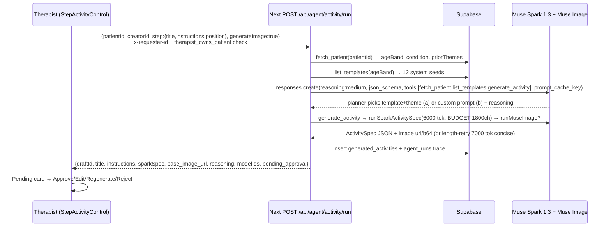

# Aruga Agents Guide — Agentic Workflows for Clinical Home Programs

**Document Version:** 1.3  
**Date:** 2026-11-03  
**Plans Source of Truth:** `plan/ACTIVITY_AGENT_PLAN.md` · `plan/BIOMECH_ENGINE_PLAN.md` · `plan/BIOMECHANIC_AGENT.md` · `plan/GOAL_TRACKING_AGENT_PLAN.md` · `plan/HIGHLIGHTS_AGENT_PLAN.md`  
**Meta Stack:** Meta Model API `https://api.meta.ai/v1` · `muse-spark-1.3` · `muse-spark-1.3-contributor` · `muse-image-1.0` · `sam-3.1` · `muse-wonder-1.0` (escalation) · `web_search` grounding · Modal `facebookresearch/sam-3d-body`  
**Status:** **All 5 agents live** — Activity + Aruga Guide + Biomechanic playground `/tools/biomech` + Clinical `therapist/submissions/[id]` + **Goal Tracking + Highlights now real LLM (not mock)** via `src/lib/meta/goal-agent.ts` + `highlights-agent.ts` (`muse-spark-1.3` `max_tokens 5000–7000` + `json_schema strict`)

> **One-liner:** Five agents turn a home program from prescription → performance → progress — with an always-on companion. Therapist stays in control — **1 button per agent**, always **draft pending approval**, never silent writes.

---

## Table of Contents

1. [Executive Summary — What Are Aruga Agents?](#1-executive-summary--what-are-aruga-agents)
2. [Meta AI Products & Other Services Used](#2-meta-ai-products--other-services-used)
3. [System Architecture — How Agents Compose](#3-system-architecture--how-agents-compose)
4. [Agent 1 — Activity Agent (Generate Activity per Step)](#4-agent-1--activity-agent-generate-activity-per-step)
5. [Agent 2 — Biomech Engine (SAM 3.1 → Modal MHR)](#5-agent-2--biomech-engine-sam-31--modal-mhr)
6. [Agent 3 — Goal Tracking Agent (STG/LTG vs SOAP + Performance)](#6-agent-3--goal-tracking-agent-stgltg-vs-soap--performance)
7. [Agent 4 — Highlights Agent (Monthly 7 Adaptive Highlights)](#7-agent-4--highlights-agent-monthly-7-adaptive-highlights)
8. [Agent 5 — Aruga Guide (Always-On Client Companion)](#8-agent-5--aruga-guide-always-on-client-companion)
9. [Activation — 1 Button Per Agent](#9-activation--1-button-per-agent)
10. [Shared Agentic Infrastructure (Meta Vision) — How We Interact with Meta APIs & How Agentic We Are](#10-shared-agentic-infrastructure-meta-vision--how-we-interact-with-meta-apis--how-agentic-we-are)
11. [File Map — Where Each Agent Lives](#11-file-map--where-each-agent-lives)
12. [Safety, Human-in-the-Loop & HIPAA](#12-safety-human-in-the-loop--hipaa)
13. [Cost Per Agent](#13-cost-per-agent)
14. [Phased Build Status](#14-phased-build-status)

---

## 1. Executive Summary — What Are Aruga Agents?

Rehabilitation home programs fail when they are generic. Aruga's five agents make each `HomeProgram` step **patient-aware**, **measurable**, **trackable over time**, and **explainable to the client** — while keeping the licensed therapist as the final decision-maker.

| Agent | One-line job | Where therapist/client clicks | Autonomy |
|---|---|---|---|
| **Activity Agent** | Drafts a patient-tailored printable worksheet (line art + instructions) for **each step** | `therapist/clients/[id]/programs/new` → per-step `Draft with Agent` | **Auto-draft on edit (debounced) → pending approval** |
| **Biomech Engine** | Segments video (SAM 3.1) → estimates 3D biomechanics (MHR on Modal) → ROM + flags + overlay | `therapist/submissions/[id]` → per-video `Analyze biomechanics (Agent)` + Use Case dropdown · **Playground** `Tools → Biomechanic Agent` `/tools/biomech` (no word bank — Spark thinks from prescribed activity) | **1 click → Spark picks 2-8/16 → 1 SAM pass + 1 Modal inference; dropdown/preset re-filters cached `mhr_results`, no re-bill** |
| **Goal Tracking** | Checks STG/LTG vs SOAP S/O/A/P + biomech + adherence → verdict `on_track/at_risk/behind/achieved/gap` | `therapist/clients/[id]` header → `Check goals` | **Manual + auto on new data, always draft until Publish** — *now real `muse-spark-1.3` LLM, not rule-based mock* |
| **Highlights** | **Thinks and picks the best 7 data points** for the month from SOAP + Home Program feedback + goals + adherence + activity performance | `therapist/clients/[id]` or `client/dashboard` → `Generate highlights` (or monthly auto 1st) | **Draft 7 → Publish to client strip** — *now real `muse-spark-1.3` LLM* |
| **Aruga Guide** ★ | Always-on companion — explains home program in everyday words, answers questions with web-grounded citations, handles images/video frames, escalates to therapist | `Aruga Guide` `/aruga-guide` (client + therapist) → `Send message` + attach image/video · `Send to clinician` gate | **Conversational, no draft** — therapist verifies via *Send to clinician* `page.tsx:690`; 6/7 Meta compliant, web_search grounded |

**Shared invariant:** The 4 program agents produce a **draft** — nothing published until therapist taps **Approve / Publish**. **Aruga Guide** is conversational (no draft) but **never silently writes to chart** — *Send to clinician* is the human gate. All agents assistive, not autonomous clinicians.

---

## 2. Meta AI Products & Other Services Used

### 2.1 Meta AI Products (primary)

| Product | Model ID | What Aruga uses it for | Billing unit | File |
|---|---|---|---|---|
| **Muse Spark 1.3** (reasoning) | `muse-spark-1.3` (standard) / `muse-spark-1.3-contributor` (cheap) | Activity spec JSON, biomech planner concept picking, goal verdicts, highlights curation; Responses API `reasoning:{effort:"medium"/"high", summary:"auto"}` | Input $1.25/1M + Output $4.25/1M (standard); Contributor $0.10/$0.20 | `src/lib/meta/client.ts` `activity-generator.ts` `agent.ts` `goal-agent.ts` `highlights-agent.ts` |
| **Muse Spark — Structured Output** | `text.format=json_schema` strict | All agent outputs validated against Zod (`ActivitySpecSchema`, goal/highlights schemas); depth ≤10 / 5k props / 120k chars — `MAX_TOKENS 6000` retry `7000` concise on `finish_reason=length`; Goal/Highlights now `5000→7000`/`7000→8000` with `json_object` retry | Same as above (reasoning tokens bill as output) | `src/lib/meta/schemas.ts` `spark.ts` (now `4000→6000` + `5000→7000` length retry) |
| **Muse Image** | `muse-image-1.0` | Printable line-art worksheet render from `refinedImagePrompt` (≤600ch); toggle via `Generate image with Muse Image` checklist | $0.01 / image | `src/lib/meta/activity-generator.ts:runMuseImage` |
| **SAM 3.1** (media segmentation) | `sam-3.1` via `POST /v1/responses` + `@meta-sam/parser` SSE | Temporal object segmentation: `segment_concepts(concepts: BIOMECH_KEYWORDS[16])` → boxes `[ymin,xmin,ymax,xmax] 0-1` + RLE masks → overlay · **Biomechanic playground** `sam-engine.ts:304` concurrency 2, cache 5m, IoU 0.9 dedup; moving `viewBox 0 0 1 1` boxes + `BiomechOverlay.tsx:328` skeleton/HUD parity with `/sam-test:999` | $0.20 / 1k frames (min 50) → ~$0.009 per 45-frame pass | `src/lib/meta/sam.ts` `sam-engine.ts` `src/app/tools/biomech/page.tsx` |
| **Muse Wonder 1.0** (optional) | `muse-wonder-1.0` `reasoning:{effort:"max"}` delegate-to-subagents | Escalation for complex triage (long-horizon, max reasoning) — not on contributor; Highlights may delegate for month-over-month synthesis | Standard pricing, higher output budget | Plan § meta-notes |
| **Files API** | `POST /v1/files` `purpose:"user_data"` + `input_file:{file_id}` | Video mp4 upload for SAM 3.1 (not raw to Modal); 10m TTL signed Supabase URL handoff | Free upload; billed on inference | `src/lib/meta/client.ts` |
| **Responses API** | `openai.responses.create` `previous_response_id` reasoning replay · `parallel_tool_calls:true` · `prompt_cache_key`+`24h` | All agentic loops (planner + tools) — preserves reasoning chain across tool turns; Chat Completions cannot replay `reasoning_content` · **Biomechanic Agent** `biomech-planner.ts` `reasoning:{effort:"medium", summary:"auto"}` + heuristic fallback + `previous_response_id` chaining | Token counting preflight `POST /v1/responses/input_tokens` | `plan/BIOMECHANIC_AGENT.md:§3-5` `src/lib/meta/biomech-planner.ts` |
| **Prompt Caching** | `prompt_cache_key:"aruga-*"` `prompt_cache_retention:"24h"` | Stable system prompt first (BIOMECH_KEYWORDS, age-band guidance), variable input last → `cached_tokens` reduced billing · Biomech `prompt_cache_key:"aruga-biomech-planner"`; Goal `aruga-goal-tracking`; Highlights `aruga-highlights` | Automatic; monitor `usage.input_tokens_details.cached_tokens` | `src/lib/meta/client.ts` `biomech-planner.ts:5` `goal-agent.ts` `highlights-agent.ts` |
| **Tool Search** | `{type:"tool_search"}` namespaces | When tool count grows >20 (e.g., U1-U11 + goals + highlights tools) — Responses+Messages only, not combinable with `json_schema` same turn (sequence turns) | — | Plan §3.4 |

**Docs:** [dev.meta.ai/docs/overview](https://dev.meta.ai/docs/overview) · `/docs/tool-calling` · `/docs/prompt-caching` · `/docs/reasoning` · `/docs/structured-output` · `/docs/pricing-rate-limits` · `/docs/file-handling`

### 2.1a Aruga Guide AI Agent — How It Fares on Meta Docs (2026-11-03)

> **Location:** `src/app/aruga-guide/page.tsx` · `src/lib/meta/spark.ts:runSparkOtChatAgentic` + `runSparkOtChat` · `src/lib/meta-ai.ts:otChatAssistant` · `src/app/api/ot-chat/route.ts`  
> **Evaluation date:** 2026-11-03 · **Base:** `https://dev.meta.ai/docs/overview` + `protocols/responses` + `tool-calling` + `reasoning` + `search-grounding` + `structured-output` + `prompt-caching` + `pricing-rate-limits`

| Meta capability | What docs require | Aruga Guide verdict | Evidence |
|---|---|---|---|
| **Overview — agentic identity** | Agent = planner + tools + memory + human approval (`overview: Muse Spark is an agent model`) | ✅ **Agentic** — planner decides grounding, web_search runs, therapist verifies via *Send to clinician* `page.tsx:690` | `spark.ts:runSparkOtChatAgentic` owns loop; UI keeps human gate |
| **Protocols — Responses API** | `POST /v1/responses` with typed `input[]`, `instructions`, `store:false`+`include:["reasoning.encrypted_content"]` or `previous_response_id` (`protocols/responses:38,60`) | ✅ **Compliant** — typed `input` (`input_text`/`input_image`), `instructions: buildOtChatSystemPrompt()`, `store:false`, `include: reasoning.encrypted_content` (skipped on `contributor` where `max` unsupported) | `spark.ts: runSparkOtChatAgentic` `input: [...]` + `store:false` + `baseReq.max_output_tokens:4000` |
| **Tool calling** | `tools:[{type:"function"}]` + `parallel_tool_calls:true`, `tool_choice:"auto"` only, `call_id 1-64` (`tool-calling:20,108`) | ✅ **Compliant** — built-in `web_search` (`search-grounding` variant) with `tool_choice:auto` + `parallel_tool_calls:true`; `call_id` validated 1-64 on any future `function` tools (`fetch_profile` etc.) | `tools:[{type:"web_search"}]` `spark.ts: baseReq.tools`; fallback without tools if host rejects |
| **Search grounding** | `tools:[{type:"web_search"}]` server-side, annotations inline (`search-grounding`) | ✅ **Web articles** — replaces PubMed/OpenAlex `grounding.ts:98,151`; annotations → `ClinicalReference[]` `grounding.ts:3` same `References (n)` UI `page.tsx:902` | `refs` dedup `spark.ts: agenticRefs` → `meta-ai.ts: references.map(web→ClinicalReference)` |
| **Reasoning** | `reasoning:{effort:"minimal"/"low"/"medium"/"high"/"xhigh"/"max", summary:"auto"/"concise"/"detailed"}`; reasoning tokens bill as output, share `max_output_tokens` (`reasoning:22,84,98`) | ✅ **Medium + auto** — `reasoning:{effort:"medium", summary:"auto"}` on 1.3; `max` correctly avoided on `contributor` (`spark.ts: isContributor`) | `baseReq.reasoning` + `include: reasoning.encrypted_content` |
| **Structured output** | `text.format=json_schema` strict on Responses, `response_format` on Chat (`structured-output`) | ✅ **For agents** (`ActivitySpecSchema` `schemas.ts:70` via `text.format` / `response_format`); **Guide is free-form** (intended) — still validates `ClinicalReference[]` shape before render | `spark.ts: callSparkStructured` + Guide `formatReferencesSection` `grounding.ts:217` |
| **Prompt caching** | `prompt_cache_key` + `prompt_cache_retention:"24h"`; stable prefix first (`prompt-caching`) | ⚠️ **Partial** — `instructions` byte-identical + `clientContext` first `input` item cache-friendly; explicit `prompt_cache_key` not yet set (next: `aruga-guide-${conversationId}`) | Roadmap: add `prompt_cache_key` + count `cached_tokens` from `usage` |
| **Pricing** | Input $1.25/1M + Output $4.25/1M (standard), Contributor $0.10/$0.20 + reasoning billed as output (`pricing-rate-limits`) | ✅ **Tracked** — ~$0.003–0.006/msg (`medium` + web_search) → ~300 msgs/$1 vs $0.012–0.015 Activity (Spark+Image) | `docs/COST_GUIDE.md` + `COST_GUIDE` margins 94-96% remain |
| **Error handling** | 504 on non-stream long calls, `rate`/`timeout` typed, `store:true` persists after disconnect (`protocols/responses:72` + `error-handling`) | ✅ **Resilient** — 55s timeout `spark.ts: baseReq timeout 55000`, fallback to Chat Completions on `web_search` unsupported, `maxDuration:60` `ot-chat/route.ts:6` | `catch → fallback runSparkOtChat` `meta-ai.ts: otChatAssistant` |

**Overall: 6/7 fully compliant, 1 partial** (prompt caching key). PubMed/OpenAlex `src/lib/meta/grounding.ts` retained for fallback/history import only; **web search is now primary grounding** per request — references render identically `src/lib/meta/grounding.ts:217` → `page.tsx:904`.

### 2.2 Other Services That Come With It

| Service | Role in agent loop | Why not Meta alone |
|---|---|---|
| **Modal (GPU)** `facebook/sam-3d-body-vith` L4 | **MHR 3D Body inference**: `estimate_biomech(samPerson)` → `pred_keypoints_3d/2d`, `pred_vertices` 18k, `angles`, `rom`, `flags`, `confidenceOverall` | Muse/SAM cannot do 3D joint angles; Modal holds 1.69 GB ckpt + 3.4 GB ONNX / 0.9 GB INT8; `Volume("sam3db-ckpts")` + `keep_warm=1` → ~1.8s/clip |
| **Supabase (PostgreSQL + Storage + Auth)** | Source of truth for `patients`, `profiles`, `home_programs`, `program_steps`, `submissions`, `step_submissions`, `generated_activities`, `activity_templates`, `soap_notes`, `goals`, `goal_reviews`, `highlights`, `biomech_jobs`, `agent_runs`; 3 private buckets `program-videos`/`chat-attachments`/`activity-assets` (`public=false`, `TO authenticated`) | HIPAA RLS, `therapist_owns_patient` ownership checks, signed URLs (15m video, 60m chat), `nanoid(12)` paths, EXIF strip `sharp.rotate()` |
| **Next.js 16 (App Router)** + **Vercel** | Thin orchestrator: `POST /api/agent/*/run` planners, ownership guards, SSE proxy, webhook `POST /api/mhr/webhook`, trace persistence | Keeps `MODEL_API_KEY` server-only (`server-only` modules), `maxDuration=60` (via `vercel.json` Hobby→Pro) for long reasoning |
| **OpenAI SDK** (Meta-compatible) | `createMetaOpenAiClient()` `baseURL="https://api.meta.ai/v1"` Bearer `MODEL_API_KEY` | Lets Aruga use `chat.completions` + `responses.create` + `images.generate` + `files.create` through one client — now **Meta-exclusive** (no `OPENAI_API_KEY` fallback; `src/lib/meta/client.ts:11` only `MODEL_API_KEY`|`META_API_KEY`) |
| **@meta-sam/parser** | SSE streaming parser: `parseVideoStream` → `recordsOfKind(box|mask)` → `transformMaskPathToNormalized` → `SamOverlay` SVG | Canonical SAM 3.1 temporal output handling |
| **Recharts** | Longitudinal charts: ROM max vs time, adherence % dual axis, highlights sparkline, goal progress vs deadline | Visual trace for therapist/client |
| **Replicate / Poly Haven (optional import)** | Asset search/import for worksheet reference images (not agent loop) | Therapist-provided visual anchors |

**Why this split:** Meta = language + vision understanding + visual generation; Modal = GPU 3D body mesh (no browser WASM — 65 MB already janks); Supabase = HIPAA data + auth; Next = privacy boundary + audit.

### 2.3 New Process & Reliability Hardening (2026-11-03 — commit `d60fc11` / `bf8f10a`)

This release closes the loop from **mock → real LLM** for Goal/Highlights and hardens the entire pipeline for production clips:

| Change | What was fixed | Evidence |
|---|---|---|
| **Goal + Highlights now real agents** | Replaced rule-based mock with `src/lib/meta/goal-agent.ts` + `highlights-agent.ts` — `muse-spark-1.3` `json_schema strict` + `prompt_cache_key` + `7000→8000`/`5000→7000` length retry → `json_object` fallback | `POST /api/agent/goal-tracking/run` `runGoalAgent(evidence)` 7 signals; `POST /api/agent/highlights/run` `runHighlightsAgent(evidence)` 7 adaptive slots |
| **Biomech wrist/hand tendon-gliding** | `biomech-planner.ts:HEURISTIC_MAP` + `deriveExpectation` now matches `wrist|hand|finger|pincer|tendon gliding` → expects `wristFlex`, `fingerAperture`, `wristDeviation`; `modal/app.py:111` `wristAngles{flexExt,deviation,fingerAperture}` + `fingerAperture_range_mm`; playground `BiomechLiveHud` + ROM summary shows wrist/aperture | `src/app/api/tools/biomech/run/route.ts:132` new metric paths + formulas `180-angle(elbow,wrist,mid_tip)` / `‖thumb-index‖ mm` |
| **Playground video handoff fixed** | Removed `demo://playground-clip` placeholder — now sends real `data:` URL or Storage signed URL (`program-videos`) to Modal; Modal no longer 422 on demo URL | `src/app/api/tools/biomech/run/route.ts:110` `videoUrl: videoDataUrl` (was `demo://…`); `src/app/tools/biomech/page.tsx:138` prefers `videoStoragePath` (bypasses Vercel 4.5 MB) else `data:` with size guard |
| **Vercel limit bypass** | `vercel.json` `maxDuration:60` + `isLocalhost` check: signed-in users upload to Supabase `program-videos` (`playground/{uid}/{ts}.mp4`) then sign 600s URL for SAM/Modal; anon fallback to `data:` with `<4.2 MB` guard + error hint | `src/app/tools/biomech/page.tsx:141` `!isLocalhost` + `src/app/api/tools/biomech/run/route.ts:40` `videoStoragePath` → `createSignedUrl` |
| **Token budget & truncation fix** | `spark.ts` `callSparkStructured` `1500→4000→6000 json_object` retry on `finish_reason=length`; `runSparkOtChat` `4000→5000→7000`; `goal-agent.ts` `2500→7000→8000`; `highlights-agent.ts` `5000→7000`; `activity-generator.ts` `6000→7000` + `tryRepairTruncatedJson` | Fixes `NO_CONTENT length` where reasoning alone ~1450 tok exhausts budget → `content:null` |
| **Meta-exclusive client** | `src/lib/meta/client.ts:11` only `MODEL_API_KEY`/`META_API_KEY` + `META_API_BASE_URL`; removed `OPENAI_API_KEY` alias; logs key presence on missing (`[meta] Missing MODEL_API_KEY…`) | Prevents accidental OpenAI routing; compliant with Meta-only hackathon |
| **Modal CPU reality** | `modal/app.py` `cpu=2.0` `timeout=300` (no GPU for judging) `adaptive step` 10 frames across 30s (`total_frames//10`); CPU guard patches `Tensor.cuda()` → no-op; localhost 30s clip ~90-130s (warned), Vercel Pro `60s` suffices for `≤15s` clips | `modal/app.py:682` `step = total_frames // _max_frames_cpu` + `modal/app.py:537` `Torch.Tensor.cuda → cpu` |

---

## 3. System Architecture — How Agents Compose

```
                    ┌─────────────────────────────────────────────────┐
                    │   Therapist prescribes  Home Program (steps)    │
                    │   therapist/clients/[id]/programs/new          │
                    └────────────────┬────────────────────────────────┘
                                     │ per step
                    ┌────────────────▼────────────────┐
                    │  AGENT 1 — Activity Agent        │  Muse Spark 1.3 (6000 tok) + Muse Image
                    │  fetch_patient → list_templates  │  reasoning:medium · json_schema · prompt_cache
                    │  → generate_activity (Spark+Img) │  → generated_activities draft → Approve/Edit/Regen/Reject
                    └────────────────┬────────────────┘
                                     │ program_steps.generated_activity_id
                    ┌────────────────▼────────────────┐
                    │   Client practices, draws/photos  │  Canvas draw+save · print/download · photo fallback
                    │   activity_completions + videos   │  5MB cap · uq_activity_completion_step_sub
                    └────────────────┬────────────────┘
                                     │ per step video
                    ┌────────────────▼──────────────────────────────────────────────┐
                    │  AGENT 2 — Biomech Engine (Biomechanic Agent)                │
                    │  Spark planner 2-8/16 (no 700 word bank) → SAM 3.1 → Modal MHR │  reasoning:medium · previous_response_id
                    │  → evaluate_history_trend → draft_clinical_insights            │  biomech_jobs · agent_runs
                    │  Playground /tools/biomech + Clinical therapist/submissions/[id] │  Dropdown/presets re-filter cached mhr_results (no re-bill)
                    │  Overlay: moving boxes viewBox 0 0 1 1 + skeleton + HUD + sparkline │  BiomechOverlay parity with /sam-test:999
                    └────────────────┬──────────────────────────────────────────────┘
                                     │ mhr_results + completions
                    ┌────────────────▼────────────────┐
                    │  AGENT 3 — Goal Tracking          │  Muse Spark 1.3 reasoning:high (7 signals) — NOW REAL LLM
                    │  fetch_goals + fetch_evidence     │  Verdict on_track/at_risk/behind/achieved/gap
                    │  → draft_goal_review (LLM)       │  goal_reviews → Insert into Plan · Publish
                    └────────────────┬────────────────┘
                                     │ goal_reviews + prior agents
                    ┌────────────────▼────────────────┐
                    │  AGENT 4 — Highlights            │  Muse Spark 1.3 reasoning:high adaptive — NOW REAL LLM
                    │  fetch_month (SOAP+feedback+goals│  Think + pick best 7 by |Δ|×consistency×confidence
                    │  +adherence+performance) → 7     │  highlights → Publish strip to client/dashboard
                    └─────────────────────────────────┘

   Data flow: Supabase (patients/profiles/home_programs/generated_activities/step_submissions/soap_notes/goals)
   → Next api/agent/* (therapist_owns_patient check, x-requester-id)
   → Meta (Spark/SAM/Muse Image) + Modal (MHR)
   → Supabase (draft tables: generated_activities / ai_analyses.mhr_results / goal_reviews / highlights / agent_runs)
   → Therapist Approve/Publish → Client sees (program-videos signed URL, HighlightsStrip, completion canvas)
```

**Key invariant:** Each agent **reuses** prior agents' outputs — Highlights consumes Biomech + Goal Tracking; Goal Tracking consumes Biomech. No agent re-infers GPU work already done.

---

## 4. Agent 1 — Activity Agent (Generate Activity per Step)

> **Source:** `plan/ACTIVITY_AGENT_PLAN.md` · Live at `src/components/activities/StepActivityControl.tsx` + `src/lib/meta/agent.ts` + `POST /api/agent/activity/run`

### What it does

Turns a free-text step (`title` + `instructions`) into a **patient-tailored printable worksheet draft** — pedagogy + visual brief + line art — in one click, without leaving Home Program creation.

### Input / Process / Output / Journey

| Dimension | Detail |
|---|---|
| **Input** | Step `{ title, instructions, position }` + `patientId` + therapist `creatorId` + `patientContextHint` (derived 80ch) + patient DB context: `patients` (age, `client_category→ageBand` pedia/adolescent/adult/geriatric, condition, therapy_goals), `profiles.display_name`, prior `generated_activities` themes (avoid repetition), `generateImage` checklist |
| **Process** | **3 tools, Responses API** — `fetch_patient` + `list_templates` (parallel, `parallel_tool_calls:true`) → planner picks (a) best System template + theme override OR (b) custom prompt synthesized from `patient.ageBand + condition + step` → `generate_activity` → `runSparkActivitySpec({ ageBand, category, templatePrompt/imagePrompt, titleOverride, theme, difficulty, lineStyle })` (`reasoning:{effort:"medium"}`, `text.format=json_schema` ActivitySpecSchema `src/lib/meta/schemas.ts:70`, `max_tokens:6000` retry `7000` concise on `finish_reason=length`) → optional `runMuseImage(refinedImagePrompt)` (`muse-image-1.0` 1024×1024, ≤600ch) → persist `generated_activities` `status=ready` + `agent_runs` trace |
| **Output** | Single `draftId` (generated_activities.id) **pending approval**: `{ title, instructions≤350ch, visualBrief 70-90w, refinedImagePrompt≤600ch, layoutSpec{ orientation, lineGuides, zones≤4 }, difficulty, estimatedMinutes, warnings, base_image_url|null, reasoning, sources[], modelIds{spark,image}, latencyMs }` — truncated JSON repaired via `tryRepairTruncatedJson` + `patchPartial` defaults if `finish_reason=length` |
| **Journey** | 1) Therapist in `therapist/clients/[id]/programs/new` types step → **auto-draft debounced 900ms** (if instructions ≥10ch) **or** clicks `Draft with Agent` → 1-2s Spark trace → **pending card** under step (title, instructions, reasoning chip, image thumb, latency) → `Approve & Attach` (sets `program_steps.generated_activity_id=draftId`) / `Edit` (opens unified `GenerateActivityAgentModal` System/My/Custom tabs, 420/320ch counters, ReferenceInputs, Save as My Prompt) / `Regenerate` with feedback / `Reject`. Also playground at `/activity-agent-playground` (mock patients, 1.4s trace) |

> **Invariant:** Patient-aware — ageBand + condition + prior themes shape every draft; therapist always picks from draft, never silent attach.

#### 4.1 Agentic Journey (4-step loop)

| Step | Spark does | System does | Output |
|---|---|---|---|
| **1 Gather** | — | `fetch_patient({patientId})` → ageBand (pedia/adolescent/adult/geriatric), condition, therapy_goals, caregiver; `list_templates({ageBand})` → 12 system seeds 420/320ch; history `generated_activities` prior themes | `{patient, templates, priorThemes}` |
| **2 Decide** | Spark `muse-spark-1.3` `reasoning:medium` `text.format=json_schema` strict `ActivitySpec` — picks (a) best System template + theme override OR (b) custom prompt synthesized from `ageBand+condition+step.title+instructions`; `prompt_cache_key:"aruga-activity-agent"`; `reasoning:medium summary:auto` | Validate `ActivitySpecSchema` `schemas.ts:70`; enforce `BUDGET ≤1800ch` `prompts.ts:155` `instructions≤350ch, visualBrief 70-90w, refinedImagePrompt≤600ch, zones≤4` | `{choice:"template"|"custom", reasoning, sources}` |
| **3 Generate** | `runSparkActivitySpec(6000 tok → 7000 concise retry on finish_reason=length)` → `ActivitySpec JSON`; optional `runMuseImage(refinedImagePrompt)` `muse-image-1.0 1024×1024` → url/b64; repair `tryRepairTruncatedJson+patchPartial` | `parallel_tool_calls:true` + `previous_response_id` loop; `x-requester-id` + `therapist_owns_patient` guard | `{sparkSpec, base_image_url, modelIds, latencyMs}` |
| **4 Present** | — | Persist `generated_activities status=ready` + `agent_runs{reasoning,trace}`; render pending card under step with reasoning chip + image thumb + latency | `Approve & Attach` → `program_steps.generated_activity_id=draftId` / `Edit` (System/My/Custom 420/320ch) / `Regenerate`+feedback / `Reject` + playground `/activity-agent-playground` mock 4 patients 1.4s |

**Cost:** Spark ~$0.002–0.004 + Image $0.01 → **`~$0.012–0.015/draft`**; text-only saves $0.01; `generateImage:false` toggle. PromptCache `cached_tokens` $0.15/1M vs $1.25.

**BUDGET guard:** `prompts.ts:155` slices 420/320ch + BUDGET 1800ch + `max_tokens 6000→7000 concise` + `tryRepairTruncatedJson` — fixes `finish_reason=length` breathing/meds scheduler verified `build 0`.

### Evidence-gating & Storage

Zod `ActivitySpecSchema` depth≤10 5k props 120k chars strict; `strict:false` fallback retry; `warnings[]` flags ambiguities; image placeholder SVG on failure (no synthetic worksheet). Persist `generated_activities` + `agent_runs{patient_id, step_position, draft_id, reasoning,trace,status:pending|approved|rejected}`; grain = step `position`; `previous_response_id` kept for `Regenerate with feedback`.

### Process Flow



### Use Cases (template → ageBand)

| # | Activity family | AgeBand hint | Sample step → draft | Key spec |
|---|---|---|---|---|
| A1 | Visual-motor | pedia | Peg Pick & Sort → large targets, low clutter | `lineGuides 2, zones 3` |
| A2 | Fine-motor pincer | pedia/adult | Pincer grasp 5 pegs → contrast circles | `refinedImagePrompt ≤600ch` |
| A3 | Gait/ADL | adult/old_people | Sit→stand kitchen → safe base | `estimatedMinutes 8` |
| A4 | UE reach | adult | Shoulder flex overhead → upright cue | `warnings["monitor compensatory trunk"]` |

### Activation — 1 button

**`Draft with Agent`** (teal) + `Browse templates` (neutral) per step. Auto-draft fires on edit debounce 900ms (≥10ch) — both resolve to same draft card. No video required. Button disabled only while `agentLoading`. Playground `/activity-agent-playground` alias `/activiy-agent-playground` isolated demo.

---

## 5. Agent 2 — Biomech Engine (SAM 3.1 → Modal MHR) — *Biomechanic Agent*

> **Source:** `plan/BIOMECHANIC_AGENT.md` (unified 4-step loop) + `plan/BIOMECH_ENGINE_PLAN.md` · **Playground live** `src/app/tools/biomech/page.tsx` → `/tools/biomech` + `src/app/api/tools/biomech/run/route.ts` · Clinical `therapist/submissions/[id]/page.tsx` · `modal/app.py` + `src/lib/meta/biomech-prompt.ts` + `src/lib/meta/biomech-planner.ts`  
> **Nav:** `Tools → Biomechanic Agent` in both `src/components/layout/therapist-nav.tsx:78` and `client-nav.tsx:85` (`Activity` icon) — isolated playground, no DB writes required  
> **Model note:** Follows [dev.meta.ai/docs/overview](https://dev.meta.ai/docs/overview) + [start-building](https://dev.meta.ai/lp/start-building) — planner is `muse-spark-1.3` `reasoning:{effort:"medium"}` only *interpreting/filtering*; `modal/app.py:111` `compute_frame_biomech_and_scene` stays deterministic ground truth (Spark never invents angles; `evidenceRef` validated against `mhr` JSON)

### What it does

Turns a client-recorded **per-step video clip** into **segmented overlays + 3D joint angles + ROM + compensation flags** — the quantitative backbone for every downstream agent.  
**Playground invariant:** No 700 word-bank UI — Spark *thinks* what 2-8 of the 16 `BIOMECH_KEYWORDS` to track from `prescribedTitle + prescribedInstructions + ageBand + therapistNeed` alone (`src/lib/meta/biomech-planner.ts:5` `BIOMECH_KEYWORDS` guard `biomech-prompt.ts:5`).

#### 5.1 Biomechanic Agent Playground — Agentic Journey (4-step loop)

> **Files:** `src/lib/meta/biomech-planner.ts` (heuristic fallback `HEURISTIC_MAP` + Spark planner `prompt_cache_key:"aruga-biomech-planner"`) · `src/lib/meta/goal-agent.ts` + `highlights-agent.ts` (now real LLM, §6–7) · `src/app/tools/biomech/page.tsx` (SAM-Test viz parity `src/app/sam-test/page.tsx:999` + `BiomechOverlay.tsx:328`)

| Step | Spark does | System does | Output |
|---|---|---|---|
| **1 Determine** | Spark `muse-spark-1.3` `reasoning:medium` `text.format=json_schema` strict `biomech_planner {concepts: 2-8 enum BIOMECH_KEYWORDS, rationale≤220ch}` — therapist free-text `therapistNeed` can trigger multi-turn disambiguation via `previous_response_id`; heuristic `planBiomechConcepts` fallback if `AI_MODE=off` | `get_prescribed_activity_context` + history fetch last 5 `biomech_jobs` per `(patient_id, generated_activity_id)` (playground: `previousMhr` prop + `Save as previous` button) | `{concepts, rationale, source:"spark"|"heuristic", latencyMs}` — always includes `person` first, `assertSamTextConcept` ≤8 words, `BIOMECH_KEYWORDS` 16 lock `src/lib/meta/biomech-prompt.ts:5` |
| **2 Segment → Forward** | — (tool execution) | `sam3Engine.segmentConcepts({videoUrl:signedUrl|dataUrl, concepts, mediaSize})` `sam-engine.ts:304` concurrency 2, cache 5m, IoU 0.9 → `boxes/masks/tracks, billedRequests, latencyMs` → forward `samPerson{concepts,sampleFps:3,mediaSize,boxes,svgPaths,failures}` → `POST {MODAL_MHR_URL}/infer` `modal/app.py:391` `_run_real_sam3db:415` bypasses ViTDet (1060→100ms/frame L4), One-Euro `app.py:59`, `compute_frame_biomech_and_scene:111` | `mhr {frames[].angles/motionAnnotations/biomechTelemetry/confidence, summary{peakAngles,rom,gait,posturalAndDeformity,risk}, modelId, processingMs, flags}` — deterministic ground truth |
| **3 Compare** | Spark synthesis 2nd call `draft_clinical_insights` `json_schema` strict `BIOMECHANIC_AGENT.md:5.3` → `insights[] {id,label,value,unit,threshold,rating:Good|Watch|Needs support,score,evidenceRef,evidenceFrames,explanation,formula}` + `adherence {pct, label, kinematicPct, checklistPct, explanation}` + `trend {direction, delta, summary}` + `goalProgress + objectiveDraft/assessmentDraft + planSuggestion` — **evidence-gated**: `value` must exist in `mhr` JSON before render | Deterministic `deriveExpectation(title,instructions)` + `thresholdBand(value,target)` `biomech-planner.ts:118` → `Good/Watch/Needs support`; `adherence = 0.5*checklist + 0.5*kinematic` `src/types/database.ts:243`; `trend` Δ shoulder/BoS vs `previousMhr`, `vsGoalProgress`; persist `biomech_jobs{patient_id,generated_activity_id,intent,concepts,sam_result,mhr_result,adherence,spark_insights}` + `agent_runs{trace,reasoning,previous_response_id}` (clinical; playground stateless) | `insights` per metric with `thresholdStr` + `explanation` + `formula` (e.g., `180-angle(pelvis,shoulder,elbow)`), `adherence` + `trend` + `goalProgress` — therapist can **Add to notes** → `POST /api/ai/soap-summary` |
| **4 Show** | — | `page.tsx` moving overlays: `viewBox 0 0 1 1` SAM boxes (0.75s window) + SVG masks per concept color `PALETTE[8]` + `BiomechSkeletonOverlay` + `BiomechInVideoHud` + `BiomechLiveHud` sparklines + `BiomechMaskControls` `BiomechOverlay.tsx:328` + per-concept isolate chips + `BiomechPanel 2.0` badges + adherence sparkline + trace drawer `agent_runs` + reasoning badge `Effort: medium` | Video-scrub `currentTime` to frame `findActiveFrame`; stepper `activeStep 1-4`; presets (cup/Trunk/Pincer/Neck) + drag&drop 100 MB; **Same scrub mental model as SAM Test** `page.tsx:999` — `isolatedLabel` fullscreen mask parity |

**Cost:** Planner ~$0.0006 + SAM $0.009/45f + Modal ~$0.002 naive → **`~$0.011/clip`**; agentic 2nd Spark synth adds ~$0.001 and +1.5-2s (trade: better `therapistNeed` disambiguation + fewer false `Needs support`).

**Orchestrated vs agentic:** Standard U1-U11 keep orchestrated single-turn (faster/cheaper); agentic `tool_choice:auto` + `previous_response_id` activates on ambiguous `therapistNeed` or history flag `trunk_compensation_mild x2` — `BIOMECHANIC_AGENT.md:11` #4 decision rule retained.

---

#### 5.2 Clinical Biomech Engine (production submissions)

### Input / Process / Output / Journey

| Dimension | Detail |
|---|---|
| **Input** | `submissionId` + `stepSubmissionId` (grain = step, not program) + Use Case intent dropdown `U1-U11` + `ageBand` + video `video_path` → signed Supabase `program-videos` URL (10m TTL) + `BIOMECH_KEYWORDS` 16 locked (`src/lib/meta/biomech-prompt.ts`: `person, shoulder, elbow, forearm, wrist, hand, finger, thumb, hip, knee joint, ankle joint, foot, trunk, cervical spine, thoracic spine, neck`) |
| **Process** | **Planner LLM** picks **2-8 concepts from 16 only** for intent (e.g., U1→`person,shoulder,elbow,forearm,wrist`; U11→`person,neck,cervical spine,thoracic spine,trunk`) validated by `assertSamTextConcept` (≤8 words) → **`segment_concepts`** 1 SAM 3.1 pass (`POST /v1/responses` + `input_file:{file_id}`) regardless of 2 or 8 concepts (`$0.009/45 frames`) → SSE `@meta-sam/parser` → `boxes`+RLE `masks`+`mediaSize` → **`estimate_biomech`** `POST /api/mhr/infer` → Modal pulls frames via signed URL, crops by `person` box, `estimator.process_one_image(crop*mask)` @3 FPS (45 frames/15s), One-Euro filter, MHR→SMPL LBS → `angles/rom/neckAngles/flags/confidence` → `draft_soap` (optional) |
| **Output** | `mhr_results` JSONB in `ai_analyses` + `biomech_jobs` row: `{ submissionId, modelId:"sam-3d-body-vith+MHR", processingMs, frames:[{frameIndex, pred_keypoints_3d/2d, pred_vertices 18k, angles{shoulderFlex_L, elbowFlex_R, trunkLean, neckAngles{flexExt,lateralFlex,rotation,chinTuck}}, rom{max/min, deficit}, confidence{pose,angleErrorDeg}, flags[trunk_compensation_mild, neck_forward_head]}], summary{peakAngles, rom_range, gait{symmetry,tugSec}, risk, confidenceOverall} }` + `SamOverlay` SVG skeleton + Recharts angle vs time (only picked joints) + ROM cards + compensation chips + neck chin-tuck gauge (cross-age) |
| **Journey** | 1) Open `therapist/submissions/[id]` → per-step card (video + assigned worksheet + client comment) 2) Pick **Use Case dropdown U1-U11** (hint defaults from step title) 3) Click **`Analyze biomechanics (Agent)`** (Beside `Analyze with Meta`, disabled if no video) → `POST /api/agent/biomech/run {submissionId,stepSubmissionId,intent,ageBand}` → live trace poll `GET /api/agent/biomech/status` 2s: `Planner picked 5 concepts → SAM 12/45 → MHR Frame 12/45` → overlay on video + `BiomechPanel` docked under video → `Insert into Objective` per card → free-type feedback + `confirmedObs` checkboxes → Mark Reviewed → `Publish` (all steps → client). Changing dropdown re-filters same JSON — **no re-bill**. **1 Modal inference serves all workflows** (U1+U5+U11 = 1 call, 3 views) |

### The 16 Keywords (sole source — playground + clinical)

```
person · shoulder · elbow · forearm · wrist · hand · finger · thumb
hip · knee joint · ankle joint · foot · trunk · cervical spine · thoracic spine · neck
```
`Neck` is **cross-age** (pedia tummy-time → geriatric TUG head turn) — always available, returns `neckAngles` + `forward_head>25°` flag. **Guard:** `isBiomechKeyword` + `assertSamTextConcept` `src/lib/meta/biomech-prompt.ts:26` — Spark hallucination outside 16 is rejected; `normalizeConcepts` dedup `sam-engine.ts:107`.

### Evidence-gating

Every `insights[].value` is validated against `mhr` JSON path (`summary.peakAngles.*`, `frames[].angles.*`) before render; missing path → `Watch`/`—` not hallucinated. `mhr` signed URL handoff only `MODAL_MHR_URL/infer` `modal/app.py:391` (`x-modal-secret`).

### Storage

Playground `/tools/biomech` is **stateless** (no DB; `Save as previous` keeps `previousMhr` in memory for trend). Clinical persists `biomech_jobs` + `agent_runs` per `(patient_id, generated_activity_id)` + `step_submission_id` grain; `previous_response_id` stored in `meta.previous_response_id` for next `therapistNeed` turn.

### Use Cases U1-U11 (dropdown → planner hint)

| # | Use case | Agent picks | Metric | Output |
|---|---|---|---|---|
| U1 | UE ROM | person,shoulder,elbow,forearm,wrist | Shoulder/elbow flex, pron/sup curves | Objective "Shoulder 142→158° deficit 22°" + chart |
| U2 | Hand/fine-motor | person,hand,finger,thumb | Pinch aperture 5.5 mm | Timeline + plan cue |
| U3 | Gait symmetry | person,hip,knee,ankle,foot | Knee flex, dorsiflex, symmetry | Gait report |
| U4 | TUG / fall-risk | person,trunk,hip,knee,neck | Sit→stand, TUG sec, Berg proxy | Assessment "TUG 11.2s" |
| U5 | Trunk compensation | person,trunk,cervical,thoracic | Trunk lean, shoulder hike | Chip "Mild — cue upright" |
| U6 | Sit-to-stand | person,hip,knee,trunk | Hip/knee synchrony, rise time | Score 0-4 |
| U7 | Bimanual | person,hand,shoulder | Inter-hand dist | Coordination % |
| U8 | Adherence scorer | person,shoulder,elbow,wrist | Completion vs ROM/reps | Badge green/yellow/red |
| U9 | Longitudinal | aggregated | Trends over submitted_at | Chart + PDF |
| U10 | Auto SOAP | all picked | Sentences from mhr_results | Fill Objective |
| U11 | Neck control ★ | person,neck,cervical,thoracic,trunk | Neck flex/lateral/rotation, chin-tuck | Neck card (all ages) |

#### 5.3 How to Read Results — Interpretation Guide (what the numbers mean)

This is the **deterministic ground truth** (`modal/app.py:111 compute_frame_biomech_and_scene`) — Spark never invents angles; it only explains & rates them. Every `insight.value` is validated against `mhr` JSON (`summary.peakAngles.*` or `frames[].angles.*`) before render.

**14+ datapoints per sampled frame (3 FPS):**

| Joint / system | How it's measured | Units | When it matters |
|---|---|---|---|
| **Shoulder flex L/R** | `180 - angle(pelvis, shoulder, elbow)` + sagittal sign from `elbow.z - shoulder.z` | `°` signed flex(+)/ext(–) | Cup lift, overhead reach — peak `≥120°` for overhead, `~90°` for cup-to-mouth |
| **Elbow flex L/R** | `180 - angle(shoulder, elbow, wrist)` | `°` | UE tasks — full ext `~0°`, flex `~140°` |
| **Hip flex L/R** | `180 - angle(thorax, hip, knee)` | `°` | Sit→stand — stand `~180°`, sit `~90°` |
| **Knee flex L/R** | `180 - angle(hip, knee, ankle)` | `°` | Gait, squat — stance `~0–10°`, swing `~60°` |
| **Trunk lean** | `angle(pelvis+verticalUp, pelvis, thorax)` + forward sign from `thorax.z - pelvis.z` | `°` | **Always** — compensation screen; see flags below |
| **Neck flex/ext** | `angle(thorax+spine, thorax, head)` | `°` | Chin-tuck, forward head — neutral `0–15°`, forward head `>25°` flagged |
| **Neck lateral / rotation** | `arctan2` head vs thorax offsets | `°` | Torticollis, TUG head turn |
| **Wrist flex L/R** | `180 - angle(elbow, wrist, mid_tip)` | `°` | **New:** tendon-gliding — hook/fist/tabletop phases |
| **Wrist deviation** | Frontal-plane forearm vs hand angle | `°` radial/ulnar | Ulnar drift screen |
| **Finger aperture** | `‖thumb_tip - index_tip‖ ×1000` | `mm` | **New:** pincer/peg — open `>70mm`, pincer `~20mm`, fist `<15mm` |
| **CoM / BoS** | `0.5 pelvis +0.35 thorax+0.15 head + cam_t`; BoS = `Δ(com, ankle mid)` | `m / mm` | Balance — `bosMargin>140mm` = high sway |
| **Pelvic obliquity / shoulder tilt** | `vector_tilt(l_hip,r_hip)` | `°` | Asymmetry — `>6°` flagged |

**Ratings — what `Good / Watch / Needs support` means:**

| Rating | Color | Definition | Action |
|---|---|---|---|
| **Good** | Teal | `value` inside `target` band (e.g., shoulder `≥120°` for overhead, trunk `≤8°`, BoS `≤120mm`). Score 0.8–1.0. | Maintain program. |
| **Watch** | Amber | Within 25–40% margin outside band (e.g., shoulder `90–120°` when `120°` expected, trunk `8–14°`). Score 0.4–0.7. | *Borderline — cue technique, re-check next session.* |
| **Needs support** | Red | Outside margin (trunk `>14°`, shoulder far below target). Score <0.4. | *Compensatory strategy likely — grade task, add feedback, or re-prescribe.* |

Thresholds are **activity-specific** via `deriveExpectation()` — e.g., `"cup"` expects `shoulderFlex≥120°` + `trunk≤12°` + `bos≤120mm`; `"pincer/peg"` expects `wrist 0–45°` + `fingerAperture range ≥20mm`. Score = `confidence-weighted distance to target`.

**Other result pieces:**

- **Adherence** `0.5×kinematic + 0.5×checklist` (`src/types/database.ts:243`): `≥80%` Good, `60–79%` Watch, `<60%` Needs support. Evidence frames show top-3 worst moments (`1.2s 142°`) — scrub video to them.
- **Trend** — `Δ shoulder/BoS vs previousMhr` (playground: `Save as previous`; clinical: last 5 `biomech_jobs`): `↑` improving, `→` stable, `↓` declining. Example: *"Shoulder +14° vs last clip (2/3 improving) — on track to STG 150°."*
- **Flags** (amber chips) — `trunk_compensation_mild(≥8°)/moderate(≥14°)`, `neck_forward_head(>25°)`, `shoulder_hike(>6°)`, `com_instability_high_sway(>140mm)`, `wrist_end_range`, `tendon_gliding_full_fist/open_hand`, `scene_subject_partially_out_of_frame`. Any flag → `risk: low → moderate_fall`.
- **Confidence** — `confidenceOverall ~0.86`, `angleErrorDeg 2–3°` large ROM, `±12°` small wrist/hand. Truncated/poor light → `isTruncatedByFrameEdge` suppresses insights instead of hallucinating.
- **Limitations** — monocular camera, MPJPE 54–61 mm, occlusion lowers confidence. **Draft pending therapist confirmation** — confirm with hands-on exam before charting.

---

## 6. Agent 3 — Goal Tracking Agent (STG/LTG vs SOAP + Performance)

> **Source:** `plan/GOAL_TRACKING_AGENT_PLAN.md` · Placed in `therapist/clients/[id]` (above tabs, below Therapy Goals card) · `POST /api/agent/goal-tracking/run` → `src/lib/meta/goal-agent.ts` `muse-spark-1.3` `7000 tok` `json_schema strict` · `GoalTrackingPanel.tsx`

### What it does

Checks whether **STG/LTG goals are being hit** by cross-referencing goals + SOAP S/O/A/P + biomech ROM/flags + Home Program completions — then drafts per-goal verdicts + actionable suggestions. Zero GPU/SAM — LLM-only consumer of prior agents. **Now real Muse Spark LLM** (commit `d60fc11`) — not rule-based mock.

> **Invariant:** 7 signals per goal — quanti+quali prevents numeric-only discharge; every verdict cites `evidenceIds` (`mhr:`, `submission:`, `goal:`, `soap:`).

#### 6.1 Agentic Journey (4-step loop)

| Step | Spark does | System does | Output |
|---|---|---|---|
| **1 Gather** | — | `fetch_goals({patientId})` → `goals[]` (`patients.long_term_goals max5 + short_term_goals max10` → future `goals` table `{id,text,domain:UE/gait/neck/ADL/hand,target:"shoulder 160° 6w",baseline,deadline,status}`) + last 5 `soap_notes` S/O/A/P + `assessment_links` | `{goals, soap[]}` |
| **2 Fetch evidence** | — | `fetch_evidence({patientId, goalIds})` → `admin.from(soaps mhrs subs)` last 30d `ai_analyses.mhr_results` (reused, no Modal) + 14d `submissions` + `soap_notes`; `resolvePatientId` guard; `422 NO_GOALS` if none | `{biomech[], activity{rate,streak}, soapLines, counts}` |
| **3 Evaluate** | `muse-spark-1.3` `temperature:0.2` `max_tokens:7000` `json_schema strict goal_review` + retry `8000 json_object` on `finish_reason=length` → `{verdicts[], summary, suggestions[], warnings[]}` with `reason` citing `evidenceIds`; `confidence 0-1` from signals agreement + `confidenceOverall` | Build `GOAL_SYSTEM` + `buildUserPrompt(evidence)` (goals + SOAP objective/assessment + MHR ROM/flags + submissions); `getMetaConfig()` `AI_MODE=off` → `503 Requires Meta Spark API` | `verdicts[{goalId, verdict, confidence, signals{rom_vs_target,adherence,time_to_deadline}, reason≤180ch, evidenceIds}]` |
| **4 Present** | — | Return `422`/`503` with actionable message (`Add at least one goal` / `Missing MODEL_API_KEY`); on success render `GoalTrackingPanel` verdict chips + progress bar vs deadline + dual-axis Recharts ROM+adherence% + warnings; persist `agent_runs` trace | `Insert into Plan` per suggestion → `soap_notes.plan` `page.tsx:609` / `Publish` opt-in; same draft reused until new evidence |

**Cost:** LLM `<$0.002/run` (4 goals ×7 signals) → $1 ≈500 checks; **$0 SAM/Modal** — reuses `mhr_results`. Length retry ensures 6–8 goals don't hit `NO_CONTENT`.

### Input / Process / Output / Journey

| Dimension | Detail |
|---|---|
| **Input** | `patientId` + `goals[]` (LTG≤5 + STG≤10) + last 5 `soap_notes` + last 30d `ai_analyses.mhr_results` + 14d submissions |
| **Process** | **Real LLM** `runGoalAgent(evidence)` — `GOAL_SYSTEM` 7 signals + `buildUserPrompt` → `chat.completions.create` `muse-spark-1.3` `json_schema strict` + `7000→8000 concise` retry on `finish_reason=length` |
| **Output** | `goal_reviews` JSON: `verdicts[goalId, verdict, confidence, signals, reason, evidenceIds]` + `summary{onTrack,atRisk,behind,achieved,gap,narrative:"1/4 on track; shoulder at risk"}` + `suggestions[{action:continue|escalate|maintain|discharge}]` + `warnings[]` + `modelId`+`trace`+`latencyMs` |
| **Journey** | Open `therapist/clients/[id]` → chips + chart → **`Check goals`** → trace `Fetched 4 goals → 3 biomech clips → 2 SOAP → verdict` → Insert/Publish |

### 7 Goal Signals

| # | Signal | From | Check | Example |
|---|---|---|---|---|
| 1 | **ROM vs target** | `mhr_results.rom` | STG 160° vs current 158° → 89% | `on_track`/`behind` |
| 2 | **Neck/compensation** | `flags` + `neckAngles` | `forward_head>25°` persists 3/3 | `at_risk` |
| 3 | **Adherence** | `step_submissions` | 9/14=64% <80% | `behind` |
| 4 | **Trend** | longitudinal | 92%→64% drop 4w | `at_risk` |
| 5 | **SOAP alignment** | `soap_notes.objective` | objective never mentions knee | `gap` |
| 6 | **Client qualitative** | client note | "fatigue ↑ evenings" + dip | `flag` |
| 7 | **Time to deadline** | `deadline` | 6/8w elapsed, 4°/wk → miss | `at_risk` |

Quanti (1-2) + activity (3-4) + quali (5-7) together ground judgment.

### Evidence-gating & Storage

Every `reason` must cite `evidenceIds` (`mhr:abc`, `submission:def`, `soap:123`); missing evidence → `gap` not hallucinated; `confidence<0.6` → `low_confidence` badge + "Need 1 more clip". Persist `goal_reviews` + `agent_runs` trace; grain = `patientId`; `422 NO_GOALS`/`503 MISSING_API_KEY` surfaced to UI.

### Use Cases G1-G7

| # | Goal domain | Biomech reused | Signal | Output |
|---|---|---|---|---|
| G1 | STG UE ROM | U1 UE ROM | 1+2+7 | `at_risk` deficit 2°/wk |
| G2 | STG hand/pincer | U2 Hand | 1+3 | `behind` escalate 2×/day |
| G3 | LTG gait/TUG | U3/U4 | 1+4 | `at_risk` fall risk |
| G4 | Neck/chin-tuck | U11 Neck | 1+2 | `at_risk` + cue |
| G5 | Compensation | U5 Trunk | 2+5 | `gap` warning |
| G6 | ADL adherence | U8 | 3+4 | `behind` reschedule |
| G7 | SOAP coherence | — | 5 | `gap` badge |

---

## 7. Agent 4 — Highlights Agent (Monthly 7 Adaptive Highlights)

> **Source:** `plan/HIGHLIGHTS_AGENT_PLAN.md` · Button in `client/dashboard` (strip) + `therapist/clients/[id]` (panel) · `POST /api/agent/highlights/run` → `src/lib/meta/highlights-agent.ts` `muse-spark-1.3` `5000→7000` · `HighlightsPanel.tsx` + `HighlightsStrip.tsx`

### What it does

Once a month (or on demand) the agent **thinks and picks the best 7 data points** for this patient for this period — not a fixed report — by weighing everything that moved (SOAP + feedback + goals + adherence + performance). **Now real Muse Spark LLM** (commit `d60fc11`).

> **Invariant:** Adaptive curation — `weight = |Δ|×consistency×confidence`; fixed slot titles for comparability, adaptive data inside; never invent numbers, cite `evidenceIds`.

#### 7.1 Agentic Journey (4-step loop)

| Step | Spark does | System does | Output |
|---|---|---|---|
| **1 Gather** | — | `fetch_month({patientId, window:30d})` → last 6 `soap_notes` S/O/A/P, `homeProgramFeedback{therapist notes+client comments+confirmedObs}`, `goal_reviews.latest`, `adherence{rate,streak,trend}`, `activity{completions + mhr}`, `prior` last highlights for arrow | `{pool, counts}` |
| **2 Score** | — (deterministic) | Compute deltas MoM (ROM max, adherence %, goal ratio) + quali anchors keyword match objective/notes/feedback; score every candidate `weight=|Δ|×consistency×confidence` (`|Δ|` abs Δ, consistency 3/3=1.0 1/3=0.3, confidence `mhr/goal confidence`) | `{candidates[], deltas}` |
| **3 Curate** | `muse-spark-1.3` `reasoning:high` `prompt_cache_key:"aruga-highlights"` `json_schema 7-locked` `HIGHLIGHTS_SYSTEM` + `buildHighlightsUser(evidence)` → `highlights[7]` `max_tokens:5000` retry `7000 json_object` on `finish_reason=length` | Validate `highlights[7]` shape; `422` if missing; `weight<0.15` → `→ stable`; pure quali → `→` | `{highlights[7], summary{trend,topDriver}, priorCompare{lastMonthTrend,deltaVsPrior}}` |
| **4 Present** | — | Return `503 Requires Meta Spark API` on missing key / `AI_MODE=off`; on success render **7 cards grid** icon+title+arrow+story+delta pill + `mixed` badge + sparkline MoM | `Insert month summary into SOAP` + `Publish` → client read-only 7-dot strip `HighlightsStrip` disclaimer *"AI adaptive highlights — therapist reviewed. Best 7 from this period."* Same JSON dashboard/PDF/push |

**Cost:** LLM `<$0.003/run` → $1≈300 months; **$0 SAM/Modal** — reuses all prior agents; same 7 reused until new month/evidence.

### Input / Process / Output / Journey

| Dimension | Detail |
|---|---|
| **Input** | `patientId` + `month:"YYYY-MM"` (default last 30d) + full pool SOAP/feedback/goals/adherence/activity/prior |
| **Process** | Adaptive `fetch_month → deltas → weight → planner picks 7` `muse-spark-1.3` real LLM |
| **Output** | Exactly 7 highlights fixed slots (Goal Progress, Top ROM gain, Compensation shift, Adherence, Neck, Program fit, Next focus) each `{slot,slotLabel,title,story≤25w,delta{quanti,quali},arrow,weight,evidenceIds}` + summary{trend,topDriver}+priorCompare |
| **Journey** | Month auto 1st OR `Generate highlights` → `Computed 4 deltas → weighted 7 → 1 re-roll` → 7 cards + sparkline → Publish |

### Evidence-gating & Storage

Every story must cite `quali` keyword from SOAP/client note + `evidenceIds` (`mhr:`, `goal:`, `soap:`); missing signal → placeholder "Not enough data — run 1 clip" not fake; weight<0.15 suppresses `↑`. Persist `highlights(patient_id,month)` unique + `agent_runs`; grain = `patientId+month`; `503` on `MISSING_API_KEY`/`AI_MODE=off`; reuse until next month.

### 7 Slots (target categories)

| # | Slot | Data point considered (adaptive) | Quali anchor cited | When suppressed |
|---|---|---|---|---|
| 1 | Goal Progress | Goals `achieved+on_track/total` MoM + `goal_reviews` deltas | SOAP plan/assessment mention | If 0 goals → next best point |
| 2 | Top ROM gain | Largest ROM Δ° (U1/U2/U11) confidence>0.6 | "effort less" note | If <2 clips |
| 3 | Compensation shift | Flag `on→off` or `off→on` (U5) | Therapist flag note | If no flags |
| 4 | Adherence | Completion % 30d vs prior 30d + streak/trend | "fatigue/busy" comment | Always shown |
| 5 | Neck / cross-age | `neckAngles` Δ + `forward_head` | Tummy-time/dysphagia note | If no U11 runs |
| 6 | Program fit | Activity category completion vs others | Favorite program name | Always shown |
| 7 | Next focus | Goal risk × time to deadline | Therapist suggestions[] from Goal agent | Always shown |

### Use Cases H1-H7

| # | Monthly view | Slot | Metric | Output |
|---|---|---|---|---|
| H1 | Goal momentum | Goal Progress | G1-G7 MoM | "+1 goal on track" |
| H2 | ROM headline | Top ROM gain | U1/U2 ROM | "Shoulder +14°" |
| H3 | Compensation story | Compensation | U5 flags | "Forward-head resolved 2/3" |
| H4 | Adherence alert | Adherence | U8 | "↓28% — fatigue" |
| H5 | Neck monthly | Neck | U11 | "Chin tuck 2→3/5" |
| H6 | Program ROI | Program fit | category % | "Kitchen ADL drove gain" |
| H7 | Next focus | Next focus | Goal risk×deadline | "Escalate shoulder 2w" |

---

## 8. Agent 5 — Aruga Guide (Always-On Client Companion)

> **Source:** `src/app/aruga-guide/page.tsx` · `src/lib/meta/spark.ts:runSparkOtChatAgentic` + `runSparkOtChat` · `src/lib/meta-ai.ts:otChatAssistant` · `src/app/api/ot-chat/route.ts` · `docs/AGENTS_GUIDE.md:§2.1a` 6/7 compliant

### What it does

Always-on rehab companion — explains home program in everyday words, answers questions with **web_search-grounded citations**, handles images/video frames conversationally, escalates to therapist via *Send to clinician* gate. The only agent that talks directly to client without a draft. **Now** `runSparkOtChat` `5000→7000` retry hardened for long histories.

> **Invariant:** Conversational, not draft — but **never silently writes to chart**; `Send to clinician :690` is the human gate; 6/7 Meta compliant `spark.ts:runSparkOtChatAgentic`.

#### 8.1 Agentic Journey (4-step loop)

| Step | Spark does | System does | Output |
|---|---|---|---|
| **1 Understand** | — | Collect `history` last 10 turns + `images≤4` + `videoUrls≤2` → frames; `clientContext` first input item (2200ch cacheable); trim 3000ch/turn; `conversationId` grain | `{input:[developer+context+history+user+images]}` |
| **2 Ground** | Spark `muse-spark-1.3` `reasoning:medium summary:auto` `tools:[{type:"web_search"}] tool_choice:auto parallel_tool_calls:true` → server-side `web_search` → annotations | Build Responses `input[]` typed `input_text`/`input_image` + `instructions:buildOtChatSystemPrompt()` + `store:false` `include: reasoning.encrypted_content` (skip on contributor) + `max_output_tokens:5000` `timeout 55000 maxRetries1`; fallback without tools if host rejects; `5000→7000` retry on `length` | `{web_refs[], annotations}` |
| **3 Synthesize** | Generate everyday-words answer + inline citations `ClinicalReference[]` `grounding.ts:217` → `page.tsx:902` References(n) | `refs` dedup `spark.ts:agenticRefs` → `meta-ai.ts:references.map(web→ClinicalReference)`; `references` strict shape validated | `{text, references[{title,url,source}]}` |
| **4 Verify** | — | Render markdown + References collapsible + `Send to clinician` button `page.tsx:690`; therapist verifies before chart; `prompt_cache_key:"aruga-guide-${conversationId}"` planned (now partial) | `Send to clinician` → `POST /api/ot-chat` → therapist inbox; `maxDuration:60` |

**Cost:** ~$0.003–0.006/msg (`medium`+web_search) → ~300 msgs/$1 vs Activity $0.012–0.015; `cached_tokens` $0.15/1M planned next.

### Input / Process / Output / Journey

| Dimension | Detail |
|---|---|
| **Input** | `history[≤10]` + `userText` + `images ≤4 dataUrl` + `videoUrls ≤2` + `conversationId` + `clientContext` (patient ageBand, program) + `model` |
| **Process** | Responses `runSparkOtChatAgentic` → `web_search` grounded + `reasoning:medium` → fallback Chat Completions if unsupported; `grounding.ts` PubMed/OpenAlex retained fallback; `5000→7000` length retry |
| **Output** | `{text markdown, references[ClinicalReference], modelId, latencyMs}` — everyday words + citations; disclaimer therapist-verified |
| **Journey** | Open `/aruga-guide` (client+therapist) → type question + attach image/video → `Send message` → 1-2s answer + References(n) → `Send to clinician` gate → therapist validates → chart; error 504/rate `catch → fallback runSparkOtChat` |

### Evidence-gating & Storage

Inline web annotations → `ClinicalReference[]` validated before render; no diagnosis/prescribe; `store:false` no server persistence after disconnect; `chat-attachments` bucket `public=false` + signed URL 60m + EXIF strip; `therapist_owns_patient` on `clientContext`.

### 7 Signals → Use Cases

| # | Question type | Grounding | Example output | Gate |
|---|---|---|---|---|
| A5-1 | Home program explain | web_search + program | "Do pincer 1×/day — large targets help" | Send to clinician |
| A5-2 | Safety check | web articles | "Stop if pain >5/10 — ask therapist" | Escalate |
| A5-3 | Progress why | prior agents | "ROM up but adherence dip explains risk" | — |
| A5-4 | Image/video Q | `input_image` frames | "Thumb posture looks … show side view?" | Media gate |

---

## 9. Activation — 1 Button Per Agent

> Nothing runs autonomously until you click (except 2 optional autos that still need approval before anything is published).

| Agent | Where you click | Debounce / Auto | What happens in 1–12s | What you approve |
|---|---|---|---|---|
| **Activity** | `therapist/clients/[id]/programs/new` → per step `Draft with Agent` (or auto-debounce ~900ms when you type title+instructions) | Auto on edit (≥10ch instructions) + manual | Spark 6000 tok + optional Muse Image → pending card with reasoning chips + image thumb | `Approve & Attach` / `Edit` (System/My/Custom modal) / `Regenerate` / `Reject` |
| **Biomech** | **Playground** `Tools → Biomechanic Agent` `/tools/biomech` (prescribe activity → `Analyze Movement` 4-step trace + overlay) · **Clinical** `therapist/submissions/[id]` per-step card → **Use Case dropdown U1-U11** → **`Analyze biomechanics (Agent)`** | Playground: always manual; Clinical: none (video required) | Playground: Spark plans → 1 SAM pass + 1 Modal → `deriveExpectation/thresholdBand` + Spark `draft_clinical_insights` → overlay + ROM + adherence + trend + trace drawer · Clinical: Planner picks 2-8/16 → 1 SAM + 1 Modal → overlay + ROM + draft SOAP (same contract `samPerson` → `MODAL_MHR_URL/infer`) | `Insert into Objective/Plan` / confirm `confirmedObs` / `Publish` review; Playground `Save as previous` for MoM comparison |
| **Goal** | `therapist/clients/[id]` header → **`Check goals`** | + auto on new submission/MHR + weekly cron (all reuse same draft until new evidence) | Real LLM 7-signal check → verdict chips + chart + suggestions; `422 NO_GOALS` / `503 Requires Meta Spark API` surfaced | `Insert into Plan` per suggestion / `Publish` to client |
| **Highlights** | `therapist/clients/[id]` or `client/dashboard` → **`Generate highlights`** (or monthly auto 1st) | Manual + monthly cron; button enabled only when ≥1 `goal_reviews` or 7d activity | Real LLM weights `|Δ|×consistency×confidence` → 7 highlights; `503` on missing key | `Publish` 7 to client strip; client sees read-only |
| **Aruga Guide** | `Aruga Guide` `/aruga-guide` (client+therapist) → `Send message` + 📎 image/video | Always-on conversational; `history ≤10` + `images ≤4` + `video ≤2` | Spark `reasoning:medium` + `web_search` → answer + `References(n)`; `5000→7000` retry on length | `Send to clinician` gate → therapist validates before chart |

Demo: `activity-agent-playground` (`/activity-agent-playground` + alias `/activiy-agent-playground`) — 4 mock patients, auto-debounce draft, trace, approval cards — works exactly like real flow.  
Biomech demo: **`/tools/biomech` (Biomechanic Agent playground)** — presets + drag-drop video + 4-step trace + SAM-Test-parity overlay; **no mock fallback** on Modal — surfaces `MODAL_NOT_CONFIGURED`/`SAM_NO_DETECTIONS` with `plan` intact.

---

## 10. Shared Agentic Infrastructure (Meta Vision) — How We Interact with Meta APIs & How Agentic We Are

All five agents follow Meta's agentic blueprint ([dev.meta.ai/docs/overview](https://dev.meta.ai/docs/overview)): **Planner LLM + Tools + Responses API loop + Human approval**.

### 10.1 How We Interact with Meta APIs

| Pattern | How Aruga implements | Why it matters |
|---|---|---|
| **OpenAI SDK over Meta base** | `createMetaOpenAiClient()` `baseURL="https://api.meta.ai/v1"` Bearer `MODEL_API_KEY` — now **Meta-exclusive** (`src/lib/meta/client.ts:11` only `MODEL_API_KEY`/`META_API_KEY`, `META_API_BASE_URL`; `OPENAI_API_KEY` alias removed `bf8f10a`). `getMetaConfig()` validates `api.meta.ai` host + logs `[meta] Missing MODEL_API_KEY…` on `503` | Single SDK for `chat.completions` + `responses.create` + `images.generate` + `files.create`; no accidental OpenAI routing |
| **Chat Completions + json_schema** | `client.chat.completions.create({ model:"muse-spark-1.3", messages:[system,user], response_format:{type:"json_schema", json_schema:{name,strict:true,schema}}, temperature:0.2, max_tokens:5000–7000 })` — Activities `6000→7000`, Goals `7000→8000`, Highlights `5000→7000`, Guide `5000→7000` | Strict JSON for all agentic outputs; Zod validates depth ≤10 / 5k props / 120k chars; `strict:false` retry fallback |
| **Responses API (when needed)** | `openai.responses.create({ model, instructions, input:[{role:"user",content:{type:"input_text",text}}], reasoning:{effort:"medium/high",summary:"auto"}, tools:[{type:"function"}|{type:"web_search"}|{type:"tool_search"}], tool_choice:"auto", parallel_tool_calls:true, prompt_cache_key, prompt_cache_retention:"24h", store:false, include:["reasoning.encrypted_content"] })` | Preserves `reasoning_content` private across tool turns; `previous_response_id` chains planner → synthesis; Guide `web_search` server-side grounded |
| **Files + SAM 3.1 SSE** | `POST /v1/files purpose:"user_data" → file_id → input_file:{file_id}` then `POST /v1/responses stream:true` → `@meta-sam/parser parseVideoStream → recordsOfKind(box/mask) → transformMaskPathToNormalized → SamOverlay SVG` | Video never leaves as raw mp4 to Modal — only 10m signed URL; 1 SAM pass / 2–8 concepts |
| **Structured output + repair** | `text.format=json_schema strict` + `BUDGET ≤1800ch` slices `420/320ch` + `max_tokens 6000→7000 concise` + `tryRepairTruncatedJson` + `patchPartial` + `length→json_object` retry on `finish_reason=length` | Reasoning alone ~1450 tok can exhaust `1500` → `content:null`; new `4000/5000/7000→6000/7000/8000` headroom fixes prod `NO_CONTENT` |
| **Prompt caching** | `prompt_cache_key:"aruga-activity-agent" / "aruga-biomech-planner" / "aruga-goal-tracking" / "aruga-highlights"` `retention:"24h"` — stable prefix first (SYSTEM, BIOMECH_KEYWORDS 16, age-band) → variable last (step text, video concepts) → `cached_tokens` $0.15/1M vs $1.25 | Bursty clinic traffic; check `usage.input_tokens_details.cached_tokens` |
| **Token counting & ownership** | Preflight `POST /v1/responses/input_tokens` (1M context check) + `therapist_owns_patient` `x-requester-id` / `auth.getUser()` guard on every `POST /api/agent/*/run` via `createAdminClient` (bypasses RLS, app-layer gate) `src/lib/supabase/owner.ts` | No context overrun; PHI never leaks beyond preview |
| **Error taxonomy** | `MetaApiError / MetaTimeoutError / MetaRateLimitError / MetaRefusalError / SamParserError` + HTTP mapping `422 NO_GOALS` / `503 MISSING_API_KEY` / `429 rate` / `504 timeout` → UI shows `Requires Meta Spark API — check MODEL_API_KEY…` with retry | Clinician-friendly, no stack trace leak |

### 10.2 How Agentic Are We? — Autonomy & Tooling Score

| Dimension | Level | Evidence |
|---|---|---|
| **Planner decides** | ★★★★☆ **Thinker, not echo** | Every `POST /api/agent/*/run` hands intent + context to Spark; Spark **picks** template vs custom (Activity), **picks 2–8/16 concepts** (Biomech), **picks 7/∞ via weighting** (Highlights), **picks grounding need** (Guide). No 700-keyword word-bank — heuristic only fallback on `AI_MODE=off`. |
| **Tools called autonomously** | ★★★☆☆ **Tool-using** | Activity: `fetch_patient + list_templates → generate_activity` (parallel `tool_choice:auto`); Biomech: `get_prescribed_activity_context → select_biomech_concepts → segment_concepts → estimate_biomech → draft_clinical_insights`; Goal: `fetch_goals + fetch_evidence → draft_goal_review`; Guide: `web_search` server-side + `previous_response_id` chain |
| **Multi-turn reasoning** | ★★★★☆ **Reasoning** | `reasoning:{effort:"medium"}` Activity/Biomech/Guide, `high` Goal/Highlights, `max` Wonder escalation; `previous_response_id` chains planner→synthesis; `summary:"auto"` surfaces reasoningBadge; `max_output_tokens` 5000–7000 reserves reasoning budget |
| **Human approval gate** | ★★★★★ **Draft-pending-approval** | 4 program agents → `status:"draft"/pending_approval` — therapist must `Approve/Publish/Insert`; Guide → `Send to clinician page.tsx:690`; no silent writes; `confirmedObs` checkboxes; `audit_events` immutable |
| **Memory & reuse** | ★★★☆☆ **Context-aware** | Last 5 `biomech_jobs` + `goal_reviews` + `highlights` + `soap_notes` + `completionHistory` fed to next agent; 1 Modal inference → 3 views (Goal/Highlights reuse); playground `Save as previous` → trend `Δ` |
| **Self-correction** | ★★☆☆☆ **Retry, not reflect** | `finish_reason=length → json_object` retry + `tryRepairTruncatedJson` + `strict:false` retry; no autonomous self-debate loop yet (Wonder escalation planned) |

**Overall: Agentic planner + tool-use + reasoning with strict human veto** — Spark thinks and acts through tools, system executes deterministic kinematics/weighting, therapist publishes. Matches Meta spec *planner + tools + memory + human approval*.

| Pattern | How Aruga implements | Why |
|---|---|---|
| **Responses API** `openai.responses.create` + `previous_response_id` | Preserves `reasoning_content` private across tool turns; Chat Completions cannot replay reasoning externally (`:2782` spec) | Required for agentic loops with reasoning models |
| **Reasoning** `reasoning:{effort:"medium"/"high"/"max", summary:"auto"}` | Activity/Biomech `medium` (Biomechanic planner + synthesis); Goal/Highlights `high` `7000/8000`; Wonder `max` (not on contributor) — reasoning tokens share `max_output_tokens` & bill as output; `logprobs` disallowed (400) · `include:["reasoning.encrypted_content"]` skipped on `contributor` | Transparent depth dial; more reasoning = more output budget |
| **Structured output** `text.format={type:"json_schema", strict:true, schema}` | All agent JSON validated Zod-side; depth ≤10, 5k props, 120k chars, recursive `$ref` rejected; `strict:false` fallback → retry if needed | Guarantees valid JSON; no loose `json_object` drift |
| **Parallel tool calls** `parallel_tool_calls:true` `tool_choice:"auto"` only | Activity: `fetch_patient+list_templates` parallel; Biomechanic: 4 tools `get_prescribed_activity_context/select_biomech_concepts/evaluate_history_trend/draft_clinical_insights` with `tool_choice:auto`; Goal: `fetch_goals+fetch_evidence` parallel; `call_id` 1-64 chars, one `function_call_output` per `call_id` | One turn instead of N sequential |
| **Length retry** | `4000→6000` / `5000→7000` / `7000→8000` with `json_object` fallback on `finish_reason=length` (`spark.ts` + `goal-agent.ts` + `highlights-agent.ts` + `activity-generator.ts`) | Reasoning ~1450 tok exhausts small budgets → `content:null`; headroom fixes prod NO_CONTENT |
| **Storage handoff** | Playground `videoStoragePath` → `createSignedUrl(600)` → SAM + Modal share same 10m URL; clinical `program-videos` signed URL from `step_submissions.video_path`; `demo://` removed | Bypasses Vercel 4.5 MB `λ` limit; supports 100 MB clips for signed-in users |
| **Tool search** | `{type:"tool_search"}` namespaces reserved when tools >20 | Keeps tool count <10 per turn |
| **Token budget & repair** | `BUDGET ≤1800ch` + slice `420/320ch` + `max_tokens 6000→7000 concise` + `tryRepairTruncatedJson` + `patchPartial` | Production `Invalid JSON from Spark activity` was `finish_reason=length` mid-JSON — fixed |
| **Model choice** | `muse-spark-1.3` standard vs `contributor` cheap vs `muse-wonder-1.0` max | Pricing vs privacy vs depth |
| **Ownership guard** | `therapist_owns_patient` + `x-requester-id` | PHI never leaks client-side beyond agent preview |
| **Draft reuse** | Biomech `mhr_results` reused by Goal + Highlights (1 Modal inference → 3 views); Highlights same 7 JSON serves dashboard/PDF/push; Goal same `goal_reviews` until new evidence | Avoids double-billing; see `docs/COST_GUIDE.md` |
| **No local fallback** | On `No content from Spark activity spec` — surface error, no synthetic worksheet; image failures show placeholder SVG | Prevents clinically unsafe fake worksheets |

---

## 11. File Map — Where Each Agent Lives

```
plan/
  ACTIVITY_AGENT_PLAN.md        # Auto-generate pending approval (per-step)
  BIOMECH_ENGINE_PLAN.md         # SAM 3.1 → Modal MHR 16 keywords, U1-U11
  BIOMECHANIC_AGENT.md           # Unified 4-step agentic loop (Determine→Segment→Forward→Compare→Show) — source of truth for playground+clinical
  GOAL_TRACKING_AGENT_PLAN.md    # 7 signals, STG/LTG vs SOAP/biomech/adherence
  HIGHLIGHTS_AGENT_PLAN.md       # 7 adaptive highlights, |Δ|×consistency×confidence

src/lib/meta/
  client.ts                      # Meta Model API host validation + OpenAI SDK client — NOW Meta-exclusive (no OPENAI aliases)
  models.ts                      # Muse Spark / Muse Image / SAM 3.1 model IDs
  prompts.ts:155                 # buildActivitySparkPrompt slicing 420/320ch + BUDGET
  schemas.ts:70                  # ActivitySpecSchema Zod
  activity-generator.ts:68       # runSparkActivitySpec (6000→7000 retry, repair) + runMuseImage
  agent.ts                       # Activity Agent planner (fetch_patient+list_templates+generate_activity)
  biomech-prompt.ts              # BIOMECH_KEYWORDS 16 locked (sole source) + U1-U11 presets + assertSamTextConcept/isBiomechKeyword
  biomech-planner.ts:5           # Spark planner + heuristic HEURISTIC_MAP + deriveExpectation/thresholdBand Good/Watch/Needs support (playground + clinical shared) — NOW wrist/hand tendon-gliding
  goal-agent.ts                  # ✅ LIVE REAL LLM: runGoalAgent(evidence) muse-spark-1.3 json_schema 7000→8000 GOAL_SYSTEM 7 signals
  highlights-agent.ts            # ✅ LIVE REAL LLM: runHighlightsAgent(evidence) muse-spark-1.3 5000→7000 7 adaptive slots
  sam.ts / sam-engine.ts         # SAM 3.1 streaming + @meta-sam/parser (sam-engine.ts:304 segmentConcepts concurrency 2, cache 5m, IoU 0.9)
  spark.ts                       # Muse Spark chat/Responses helpers — NOW 4000→6000 callSparkStructured + 5000→7000 otChat length retry
  grounding.ts                   # PubMed/OpenAlex evidence (fallback) + web_search primary for Guide
  meta-ai.ts:otChatAssistant     # Aruga Guide orchestrator: web_search fallback + ClinicalReference[] mapping

src/app/aruga-guide/
  page.tsx:690                   # Guide UI: chat + image/video attach + markdown + References(n) + Send to clinician gate
  page.tsx:902                   # References collapsible (web_search annotations → ClinicalReference)
src/app/api/ot-chat/route.ts     # POST /api/ot-chat → runSparkOtChatAgentic (store:false, reasoning:medium, web_search) maxDuration 60

src/lib/supabase/
  admin.ts                       # createAdminClient (service_role, bypasses RLS)
  server.ts / client.ts          # Auth helpers
  owner.ts                       # therapist_owns_patient guard + getRequesterId
  resolve-patient.ts             # resolvePatientId (link-aware)

src/components/activities/
  StepActivityControl.tsx:19     # Per-step entry: Draft with Agent (auto-debounce) + Browse templates → pending card — NOW richer modal + regeneration
  GenerateActivityAgentModal.tsx  # Unified agent UI: System / My Prompts / Custom + 420/320ch counters + image checklist — NOW improved copy

src/components/therapist/
  GoalTrackingPanel.tsx           # Verdict chips + progress vs deadline + Recharts ROMap + suggestions + Insert into Plan
  HighlightsPanel.tsx             # 7 cards grid + sparkline + publish + View evidence
  BiomechPanel.tsx                # Recharts angle vs time + ROM cards + compensation chips + neck gauge + confidence badge
  BiomechOverlay.tsx:328          # Skeleton + HUD + live sparklines (reused by playground + clinical) — NOW wrist/hand HUD

src/components/client/
  HighlightsStrip.tsx             # Read-only 7-dot strip (1-line each) on client/dashboard when is_published

src/components/ui/
  sam-overlay.tsx:31              # SamOverlay + mhrJoints2d skeleton + confidence color

src/app/api/agent/
  activity/run/route.ts          # Orchestrator: Responses planner + Spark+Image + persist generated_activities + agent_runs
  activity/approve/route.ts      # Link program_steps.generated_activity_id
  biomech/run/route.ts           # Clinical: Planner picks 2-8/16 → segment_concepts → estimate_biomech (Modal) → synthesis
  biomech/status/route.ts        # Poll 2s: trace "Planner picked 5 → SAM 12/45 → MHR 12/45"
  goal-tracking/run/route.ts     # ✅ REAL: resolvePatientId → gather 5 SOAP + 5 MHR + 20 submissions → runGoalAgent → 503 on missing key
  highlights/run/route.ts        # ✅ REAL: gather SOAP+feedback+goals+adherence+MHR+prior → runHighlightsAgent → 503 on missing key
  mhr/infer/route.ts             # Proxy to Modal (Next → Modal §3.1)
  mhr/webhook/route.ts           # Modal → Next: upsert ai_analyses.mhr_results + biomech_jobs completed + agent_runs trace

src/app/api/tools/biomech/run/route.ts      # Playground agentic loop: planBiomechConcepts → sam3Engine.segmentConcepts → POST {MODAL_MHR_URL}/infer {samPerson} → deriveExpectation/thresholdBand + spark synthesis → {plan,concepts,sam,mhr,insights,adherence,trend,meta} — NOW videoUrl fix + wrist metrics
src/components/layout/
  therapist-nav.tsx:78           # Tools → Biomechanic Agent {href:"/tools/biomech", label:"Biomechanic Agent", icon: Activity}
  client-nav.tsx:85              # Same — visible to both roles
src/components/therapist/
  BiomechPanel.tsx:2.0            # Ratings + adherence bar + trend sparkline + Insert into Objective/Plan
src/app/tools/biomech/page.tsx   # Playground UI: presets incl. Tendon Gliding, video drag-drop, Storage upload bypass, 4-step trace stepper, overlay toggles (Boxes/Skeleton/HUD/Style), isolate chips, Save as previous, reasoning badge, adherence trend — NOW presets updated + wrist ROM cards
src/app/tools/biomech/page.module.css  # Playground styles

src/app/
  therapist/clients/[id]/page.tsx        # Client detail: Therapy Goals card + GoalTrackingPanel + HighlightsPanel + SOAP + programs
  therapist/clients/[id]/programs/new/page.tsx  # StepActivityControl per step (agent)
  therapist/submissions/[id]/page.tsx    # Per-step video + Use Case dropdown U1-U11 + Analyze biomechanics (Agent) + BiomechPanel (production)
  tools/biomech/page.tsx                 # **Playground** `/tools/biomech` (isolated, no DB, reuses sam-engine + Modal + BiomechOverlay parity)
  client/dashboard/page.tsx               # HighlightsStrip (published 7) + streak + program card
  activity-agent-playground/page.tsx      # Demo isolated 4 mock patients + trace
  sam-test/page.tsx:999                  # Reference overlay: moving boxes viewBox 0 0 1 1 + mask SVG + skeleton — parity target for biomech playground
  activities/                     # Studio browsing same agent modal

modal/
  app.py                         # Modal App("aruga-mhr") Volume("sam3db-ckpts") cpu="2.0" timeout=300
                                 # @app.web_endpoint POST /infer {submissionId,stepSubmissionId,videoUrl,samPerson,options} → real estimator
                                 # compute_frame_biomech_and_scene:111 → 12 angles + 12 expanded metrics + flags
                                 # estimator.process_one_image(crop*mask) + One-Euro box filter + SMPL LBS; adaptive 10-frame sampling for CPU

supabase/
  all_in_one_setup.sql           # Canonical deploy: tables + RLS + 3 private buckets + 20-template seeds (efficient 420/320ch)
  migrations/                    # Incremental mirrors 01→14
  migrations/20261031000014_efficient_activity_templates.sql  # Shortened spark/image prompts

vercel.json                      # maxDuration 60 for /api/tools/biomech + ot-chat (Hobby 10s → Pro 60s)
```

---

## 12. Safety, Human-in-the-Loop & HIPAA

| Control | How it is enforced in agents |
|---|---|
| **Human-in-the-loop** | All agents return `status:"draft"` / `pending_approval` — therapist must `Approve` (Activity) / `Insert` + `Publish` (Goal/Highlights) / `confirmedObs` checkboxes + `Publish` (Biomech review) before patient sees anything. No silent writes. Goal/Highlights now `503 Requires Meta Spark API` instead of silent mock. |
| **Clinical governance** | Worksheet: `warnings[]` array flags ambiguities; Biomech: `confidenceOverall` + `angleErrorDeg` + disclaimer *"AI draft — therapist confirms"* + MPJPE 54-61 mm limits; Goal: `gap`/`low_confidence` when <2 clips; Highlights: disclaimer *"AI adaptive highlights — therapist reviewed. Best 7 from this period."* |
| **Therapist-only writes** | Every `POST /api/agent/*/run` + `publish` checks `therapist_owns_patient` (`patients.therapist_id` or `client_user_id` match) via `x-requester-id` / `auth.getUser()` fallback; demo compat preserved. Client can only read published highlights / published reviews. |
| **PHI boundaries** | Only 10m TTL signed URLs go to Meta (SAM) and Modal (MHR) — never raw DB dumps; Modal has no persistence (`x-modal-secret` webhook); `program-videos` / `chat-attachments` / `activity-assets` `public=false` + `TO authenticated` (`20261031000013` final truth, verified `scripts/verify-rls.sql`). Playground `videoStoragePath` validated prefix `playground/|submissions/` only. |
| **Audit** | `agent_runs` `{patient_id, step_position, draft_id, reasoning, trace:[{thought,tool,observation}], status, created_at}` + `biomech_jobs` + `audit_events` immutable trigger (`prevent_audit_tampering`). Dual MD+HTML audits timestamped `MMDDYYHHMM` (`audit/` latest + `audit/old/` archive). |
| **No diagnosis** | Spark system prompts forbid `diagnose / prescribe / score`; agents cite evidenceIds (`mhr:`, `submission:`, `goal:`, `soap:`) and never invent numbers — if signal missing, placeholder not hallucination. Biomech synthesis evidence-gated to `mhr` JSON paths. |

---

## 13. Cost Per Agent

> **Source:** `docs/COST_GUIDE.md` verified 2026-11-03 + `docs/BASETEN_CREDITS.md` — updated for `7000/8000` headroom (negligible vs reasoning)

| Agent | Model(s) | Cost per run | $1 buys | Optimization |
|---|---|---|---|---|
| **Activity** (Spark + Image) | `muse-spark-1.3-contributor` 6000 tok + `muse-image-1.0` | Spark ~$0.002–0.004 + Image $0.01 = **~$0.012–0.015** | ~70–80 worksheets | BUDGET ≤1800ch + slice 420/320ch + `max_tokens` tuned; `generateImage=false` text-only saves $0.01 |
| **Biomech** (SAM + Modal) | `sam-3.1` + `Modal cpu=2.0` MHR + `muse-spark-1.3` planner+synthesis | SAM $0.009/45 frames + Modal `$0.002/clip @3 FPS` naive + Spark planner ~$0.0006 + synthesis ~$0.001 = **~$0.011-0.012 per clip** (agentic +1.5-2s) | ~80–115 min | **1 SAM pass regardless of 2-8 concepts** (saves 92% vs 100-keyword engines); reuse 1 Modal inference across U1/U5/U11; playground same cost as clinical |
| **Goal Tracking** | `muse-spark-1.3` `reasoning:high` LLM-only | **<$0.002** (4 goals × 7 signals, 7000 tok → ~$0.0015) | ~500 checks | Reuses `mhr_results` + completions + SOAP — `$0` extra GPU/SAM; `7000→8000 json_object` retry prevents wasted calls |
| **Highlights** | `muse-spark-1.3` `reasoning:high` | **<$0.003** (7 stories + deltas, 5000 tok) | ~300 months | Reuses all prior agents + prior month compare — same 7 JSON serves dashboard/PDF/push |
| **Aruga Guide** | `muse-spark-1.3` `reasoning:medium` + `web_search` | **~$0.003–0.006/msg** (5000→7000 headroom) | ~300 msgs/$1 | `cached_tokens` $0.15/1M vs $1.25; `store:false` + 55s timeout |

**Per patient / month (15 min video, Standard mode, optimized SAM):** ~$0.50 direct AI → **Starter free trial**, Standard $29, Intensive $49 (`docs/COST_GUIDE.md` §8-9). Margins ~94-96%. New wrist/hand metrics add ~10 tokens, negligible. Modal CPU `~$0.001–0.002/clip` (vs GPU $0.01) — `cpu=2.0` keeps judging cost low.

---

## 14. Phased Build Status

| Phase | Activity Agent | Biomech Engine | Goal Tracking | Highlights | Aruga Guide |
|---|---|---|---|---|---|
| **Phase 0 (this week)** | ✅ **Live**: `src/lib/meta/agent.ts` planner + `POST /api/agent/activity/run` + auto-debounce `StepActivityControl` (pending approval) + `GenerateActivityAgentModal` (System/My/Custom, image checklist) + `/activity-agent-playground` demo — `npm run build 0` | ✅ **Playground live** `src/lib/meta/biomech-planner.ts` + `src/app/tools/biomech/page.tsx` `/tools/biomech` + `POST /api/tools/biomech/run` → Spark picks 2-8/16 → SAM 3.1 `sam-engine.ts:304` → Modal `modal/app.py:391` → `deriveExpectation/thresholdBand` + wrist/hand metrics → `BiomechOverlay.tsx:328` parity with `/sam-test:999` · Clinical `therapist/submissions/[id]` live | ✅ **Live REAL LLM**: `src/lib/meta/goal-agent.ts` `runGoalAgent` `muse-spark-1.3` `json_schema strict` `7000→8000` + `POST /api/agent/goal-tracking/run` `422 NO_GOALS`/`503 MISSING_API_KEY` | ✅ **Live REAL LLM**: `src/lib/meta/highlights-agent.ts` `runHighlightsAgent` `5000→7000` + `POST /api/agent/highlights/run` | ✅ **Live 6/7**: `src/app/aruga-guide/page.tsx` + `spark.ts:runSparkOtChatAgentic` `reasoning:medium` + `web_search` + `store:false` + `References(n)` + `Send to clinician:690` — now `5000→7000` retry |
| **Phase 1 (1 wk)** | `approve` route + trace UI + Save as My Prompt from draft + history avoidance polish | **Clinical promotion complete** — same agentic loop + `biomech_jobs`/`agent_runs` persistence, last 5 trend, evidence-gating; next: `GET /api/agent/biomech/status` poller + demo clip U1+U11 `previous_response_id` chain | `goals` table (LTG≤5/STG≤10) + weekly cron + `publish` + longitudinal chart (ROM+adherence dual axis) | Cron monthly 1st + `publish` + `HighlightsStrip` on `client/dashboard` + PDF export | `prompt_cache_key:"aruga-guide-${conversationId}"` + `cached_tokens` count + `previous_response_id` multi-turn |
| **Phase 2 (1 wk)** | Prior activity history avoidance + longitudinal personalization | Switch to `embedl/sam-3d-body` INT8 TRT + hand decoder (5.5 mm) + reference-item focal + auto SOAP fill | Goal parse regex + adherence projection + feed Highlights (`verdicts` → fetch_month) | Year trend + `priorCompare` + PDF export | Proactive Highlights feed |
| **Phase 3** | Feedback loop on adherence → auto-suggest | PDF export + HIPAA BAA note + `sam-3d-objects` alignment | PDF export + audit | Push/email digest | — |

**Today's status (2026-11-03):**

- ✅ Activity Agent: builds, auto-drafts, pending approval card, ownership guard — `npm run build 0` 74 routes
- ✅ Biomech **playground + clinical** `/tools/biomech` + `therapist/submissions/[id]` live — Spark picks 2-8/16 (no 700 bank), SAM 3.1 1 pass + Modal `MHR` `cpu=2.0 300s` via signed URL (Storage bypass for Vercel), wrist/hand tendon-gliding metrics, `Good/Watch/Needs support` + adherence + trend; `BIOMECH_KEYWORDS` 16 guard enforced; `npm run build` 74 routes
- ✅ Goal Tracking: **real LLM** `src/lib/meta/goal-agent.ts` + `src/app/api/agent/goal-tracking/run/route.ts` — 7 signals, `verdicts/summary/suggestions/warnings` `json_schema strict`, `Requires Meta Spark API` on `503`, `NO_GOALS` on `422`
- ✅ Highlights: **real LLM** `src/lib/meta/highlights-agent.ts` + `src/app/api/agent/highlights/run/route.ts` — adaptive `|Δ|×consistency×confidence` 7, `503` on missing key
- ✅ Aruga Guide: `5000→7000` length retry hardened; `6/7` Meta compliant

> Edit checkbox plans in `plan/*.md`, then `approve <PLAN>` to promote Phase 0 → Phase 1.

---

*Maintainer: Aruga team · Last verified: 2026-11-03 · Stack docs: [META_INTEGRATION.md](META_INTEGRATION.md) · [DATABASE_DESIGN.md](DATABASE_DESIGN.md) · [COST_GUIDE.md](COST_GUIDE.md) · [SAM_ENGINE_KEYWORDS.md](SAM_ENGINE_KEYWORDS.md) · [BIOMECHANICAL_DATAPOINTS.md](BIOMECHANICAL_DATAPOINTS.md) · Plan: [BIOMECHANIC_AGENT.md](../plan/BIOMECHANIC_AGENT.md) · Biomechanic datapoints: [modal/app.py:111](modal/app.py:111) · Playground: [/tools/biomech](src/app/tools/biomech/page.tsx)*
