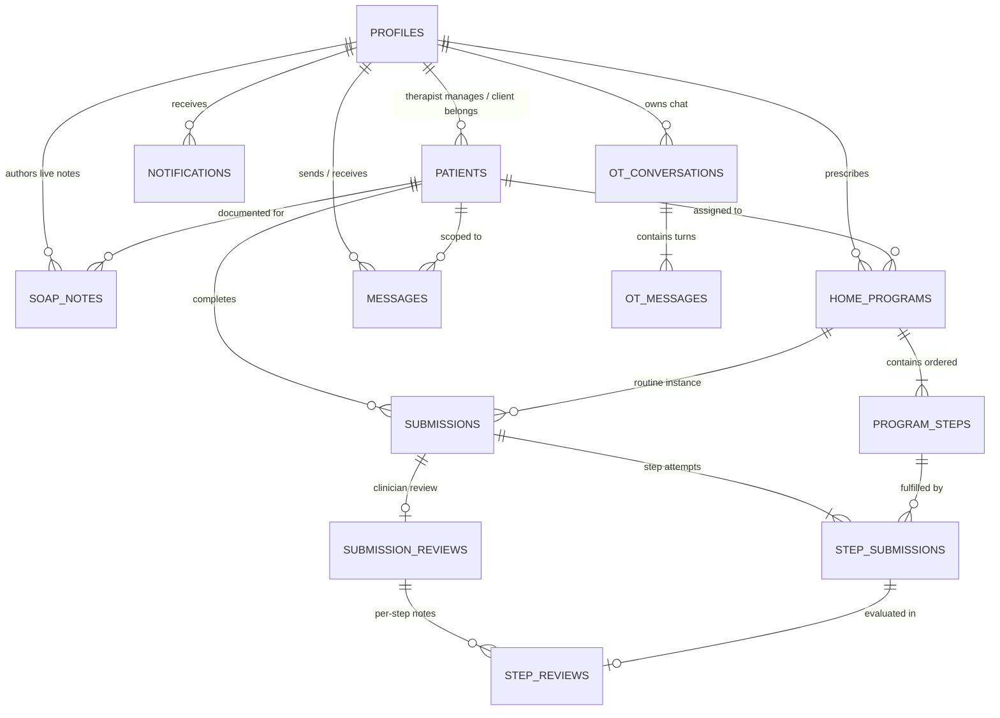

# Aruga Relational Database Design & Architecture
**Document Version:** 2.0  
**Updated for Commit:** `e5a7bd6` (feaures 50%)  
**Schema Definition:** PostgreSQL 15+ (Supabase) with Row-Level Security (RLS)  

---

## 1. Architectural Overview

Aruga’s data architecture enforces a strict **clinician-directed medical paradigm**. The database balances HIPAA-compliant access controls, relational integrity for multi-step rehabilitation routines, high-resolution video storage metadata, two-way clinician-patient linking handshakes, seamless care transfers, and clinical SOAP documentation.

### Core Architecture Tenets:
1. **Zero-Trust Clinical Governance**: Clients can only view exercise programs explicitly assigned to them, and feedback is strictly concealed while in `draft` state until atomically published by a licensed therapist.
2. **Multi-Box SOAP Clinical Partitioning**: Clinical records are segmented into Subjective, Objective, Assessment, and Plan fields, alongside plain-English family summaries cached for zero-credit client viewing.
3. **Caseload Portability & Care Continuity**: Patients can be transferred between therapists while maintaining a cryptographic audit trail (`previous_therapist_id` and `handover_notes`).
4. **Credential Privacy Lifecycle**: Temporary passwords generated during therapist client onboarding are permanently wiped from the database (`NULL`) upon the client's initial login.

---

## 2. Entity-Relationship (ER) Diagram



---

## 3. Relational Schema & Table Specifications

### 3.1 `public.profiles`
Stores extended user profile metadata for both clinicians and clients, mirroring Supabase `auth.users(id)`.

| Column | Type | Constraints | Description |
| :--- | :--- | :--- | :--- |
| `id` | `UUID` | `PK`, `REFERENCES auth.users(id) ON DELETE CASCADE` | Unique user identity matching auth provider |
| `role` | `TEXT` | `NOT NULL`, `CHECK (role IN ('therapist', 'client'))` | Platform access privilege |
| `full_name` | `TEXT` | `NOT NULL DEFAULT ''` | Display name for user |
| `email` | `TEXT` | `DEFAULT ''` | Searchable contact and handshake email |
| `temporary_password` | `TEXT` | `DEFAULT NULL` | Temp password generated for client; wiped upon first login |
| `clinician_discipline`| `TEXT` | `DEFAULT 'OT'` | OT, PT, SLP (Clinicians only) |
| `license_number` | `TEXT` | `DEFAULT ''` | Professional medical license ID |
| `clinic_name` | `TEXT` | `DEFAULT ''` | Practice facility or hospital department |
| `specialties` | `TEXT[]`| `DEFAULT '{}'` | Array of clinical specialties (e.g. Neuro, Pediatrics, Hand) |
| `contact_phone` | `TEXT` | `DEFAULT ''` | Office telephone or clinic contact |
| `office_hours` | `TEXT` | `DEFAULT ''` | Consultation and telemetry hours |
| `bio` | `TEXT` | `DEFAULT ''` | Clinician bio and care philosophy |
| `date_of_birth` | `DATE` | `DEFAULT NULL` | Client DOB for age demographic classification |
| `primary_condition` | `TEXT` | `DEFAULT ''` | Medical diagnosis (e.g., Post-Stroke Hemiparesis) |
| `caregiver_name` | `TEXT` | `DEFAULT ''` | Co-runner / parent name for pediatric & geriatric cases |
| `therapy_goals` | `TEXT` | `DEFAULT ''` | Client rehabilitation goals |
| `created_at` | `TIMESTAMPTZ`| `DEFAULT now()` | Record creation timestamp |
| `updated_at` | `TIMESTAMPTZ`| `DEFAULT now()` | Record last modification timestamp |

---

### 3.2 `public.patients`
Represents the therapeutic caseload linkage between a therapist and a client.

| Column | Type | Constraints | Description |
| :--- | :--- | :--- | :--- |
| `id` | `UUID` | `PK DEFAULT gen_random_uuid()` | Unique patient record identity |
| `therapist_id` | `UUID` | `NOT NULL REFERENCES public.profiles(id)` | Current supervising clinician |
| `client_user_id` | `UUID` | `REFERENCES auth.users(id) ON DELETE SET NULL` | Linked client auth ID (nullable for unclaimed records) |
| `name` | `TEXT` | `NOT NULL` | Patient name |
| `email` | `TEXT` | `DEFAULT NULL` | Patient email used for invitations and account matching |
| `date_of_birth` | `DATE` | `DEFAULT NULL` | Demographic age calculator |
| `category` | `TEXT` | `CHECK (category IN ('adult', 'adolescent', 'pedia', 'old_people'))` | Demographic categorization |
| `condition` | `TEXT` | `NOT NULL DEFAULT ''` | Diagnosis / clinical presentation |
| `caregiver_name` | `TEXT` | `DEFAULT ''` | Caregiver co-runner name |
| `status` | `TEXT` | `DEFAULT 'active'` | `active`, `archived`, `discharged` |
| `invitation_status`| `TEXT` | `DEFAULT 'accepted' CHECK (invitation_status IN ('pending', 'accepted', 'declined'))` | Two-way handshake state |
| `invitation_initiated_by` | `TEXT` | `DEFAULT 'therapist' CHECK (invitation_initiated_by IN ('therapist', 'client'))` | Initiator of linkage |
| `previous_therapist_id` | `UUID` | `REFERENCES public.profiles(id)` | Care transfer source clinician |
| `handover_notes` | `TEXT` | `DEFAULT NULL` | Clinical summary transferred during handover |
| `created_at` | `TIMESTAMPTZ`| `DEFAULT now()` | Linkage creation timestamp |
| `updated_at` | `TIMESTAMPTZ`| `DEFAULT now()` | Linkage update timestamp |

---

### 3.3 `public.soap_notes` (New in Migration 000006)
Multi-box clinical notes authored during or after live in-person or telehealth sessions.

| Column | Type | Constraints | Description |
| :--- | :--- | :--- | :--- |
| `id` | `UUID` | `PK DEFAULT gen_random_uuid()` | Unique session note ID |
| `patient_id` | `UUID` | `NOT NULL REFERENCES public.patients(id) ON DELETE CASCADE` | Associated patient record |
| `therapist_id` | `UUID` | `NOT NULL REFERENCES public.profiles(id) ON DELETE CASCADE` | Authoring clinician |
| `session_date` | `TIMESTAMPTZ`| `DEFAULT now()` | Date and time session occurred |
| `session_title` | `TEXT` | `NOT NULL DEFAULT 'Live Therapy Session'` | Session descriptor |
| `subjective` | `TEXT` | `NOT NULL DEFAULT ''` | **S**: Patient quotes, fatigue, comfort, pain levels |
| `objective` | `TEXT` | `NOT NULL DEFAULT ''` | **O**: Measured ROM, grip force, reps, completion metrics |
| `assessment` | `TEXT` | `NOT NULL DEFAULT ''` | **A**: Neuromuscular progression, compensatory patterns |
| `plan` | `TEXT` | `NOT NULL DEFAULT ''` | **P**: Next steps, routine modifications, assigned drills |
| `client_summary`| `TEXT` | `NOT NULL DEFAULT ''` | Plain-English summary for patient & family (DB-cached) |
| `created_at` | `TIMESTAMPTZ`| `DEFAULT now()` | Creation timestamp |
| `updated_at` | `TIMESTAMPTZ`| `DEFAULT now()` | Modification timestamp |

---

### 3.4 `public.home_programs` & `public.program_steps`
Prescribed rehabilitation routines and their atomic exercise steps.

#### `home_programs`:
- `id` (`UUID PK`)
- `patient_id` (`UUID REFERENCES patients(id) ON DELETE CASCADE`)
- `therapist_id` (`UUID REFERENCES profiles(id)`)
- `title` (`TEXT NOT NULL`)
- `discipline` (`TEXT NOT NULL DEFAULT 'OT'`)
- `status` (`TEXT DEFAULT 'assigned' CHECK (status IN ('draft', 'assigned', 'archived'))`)
- `created_at`, `updated_at` (`TIMESTAMPTZ`)

#### `program_steps`:
- `id` (`UUID PK`)
- `program_id` (`UUID REFERENCES home_programs(id) ON DELETE CASCADE`)
- `position` (`INT NOT NULL DEFAULT 1`)
- `title` (`TEXT NOT NULL DEFAULT ''`)
- `instructions` (`TEXT NOT NULL`)
- `video_criteria` (`TEXT NOT NULL DEFAULT ''`)
- `target_reps` (`INT DEFAULT NULL`)
- `duration_seconds` (`INT DEFAULT 30`)

---

### 3.5 `public.submissions` & `public.step_submissions`
Captures client performance, recorded video evidence, and skip rationales.

#### `submissions`:
- `id` (`UUID PK`)
- `program_id` (`UUID REFERENCES home_programs(id) ON DELETE CASCADE`)
- `patient_id` (`UUID REFERENCES patients(id) ON DELETE CASCADE`)
- `state` (`TEXT NOT NULL DEFAULT 'draft' CHECK (state IN ('draft', 'submitted', 'reviewed', 'archived'))`)
- `submitted_at` (`TIMESTAMPTZ DEFAULT NULL`)
- `reviewed_at` (`TIMESTAMPTZ DEFAULT NULL`)

#### `step_submissions`:
- `id` (`UUID PK`)
- `submission_id` (`UUID REFERENCES submissions(id) ON DELETE CASCADE`)
- `program_step_id` (`UUID REFERENCES program_steps(id) ON DELETE CASCADE`)
- `video_path` (`TEXT DEFAULT NULL`) — Path to file in `program-videos` storage bucket
- `client_comment` (`TEXT DEFAULT NULL`)
- `skipped` (`BOOLEAN NOT NULL DEFAULT FALSE`)
- `skip_reason` (`TEXT DEFAULT NULL`) — Mandatory if `skipped = true`

---

### 3.6 `public.submission_reviews` & `public.step_reviews`
Clinician evaluation and feedback records.

#### `submission_reviews` (Extended in Migration 000006):
- `id` (`UUID PK`)
- `submission_id` (`UUID UNIQUE REFERENCES submissions(id) ON DELETE CASCADE`)
- `therapist_id` (`UUID REFERENCES profiles(id)`)
- `overall_feedback` (`TEXT NOT NULL DEFAULT ''`) — Synthesized clinician commentary
- `subjective` (`TEXT NOT NULL DEFAULT ''`) — **S** box for home routine review
- `objective` (`TEXT NOT NULL DEFAULT ''`) — **O** box for home routine review
- `assessment` (`TEXT NOT NULL DEFAULT ''`) — **A** box for home routine review
- `plan` (`TEXT NOT NULL DEFAULT ''`) — **P** box for home routine review
- `client_summary` (`TEXT NOT NULL DEFAULT ''`) — Plain-English patient summary (DB-cached)
- `status` (`TEXT NOT NULL DEFAULT 'draft' CHECK (status IN ('draft', 'published'))`)
- `published_at` (`TIMESTAMPTZ DEFAULT NULL`)

#### `step_reviews`:
- `id` (`UUID PK`)
- `review_id` (`UUID REFERENCES submission_reviews(id) ON DELETE CASCADE`)
- `step_submission_id` (`UUID REFERENCES step_submissions(id) ON DELETE CASCADE`)
- `therapist_note` (`TEXT NOT NULL DEFAULT ''`)
- `confirmed_observations` (`TEXT[] DEFAULT '{}'`) — Clinician-confirmed Meta AI video detections

---

### 3.7 `public.messages` & `public.notifications`
Communication channels and event distribution.

#### `messages`:
- `id` (`UUID PK`)
- `patient_id` (`UUID REFERENCES patients(id) ON DELETE CASCADE`)
- `sender_id` (`UUID REFERENCES profiles(id)`)
- `recipient_id` (`UUID REFERENCES profiles(id)`)
- `content` (`TEXT NOT NULL`)
- `routine_reference_id` (`UUID REFERENCES home_programs(id) ON DELETE SET NULL`) — Support for `@routine` mention chips
- `is_deleted` (`BOOLEAN NOT NULL DEFAULT FALSE`) — Message deletion marker
- `created_at` (`TIMESTAMPTZ DEFAULT now()`)

#### `notifications`:
- `id` (`UUID PK`)
- `user_id` (`UUID NOT NULL REFERENCES profiles(id) ON DELETE CASCADE`)
- `type` (`TEXT NOT NULL CHECK (type IN ('review_published', 'program_assigned', 'message_received', 'invitation_received', 'transfer_received'))`)
- `title` (`TEXT NOT NULL`)
- `body` (`TEXT NOT NULL`)
- `link_url` (`TEXT DEFAULT NULL`)
- `is_read` (`BOOLEAN NOT NULL DEFAULT FALSE`)
- `created_at` (`TIMESTAMPTZ DEFAULT now()`)

---

### 3.8 `public.sam_test_records`
Telemetry table recording SAM 3.1 multi-concept performance across the 7 lifespan engines.

- `id` (`UUID PK`)
- `user_id` (`UUID REFERENCES profiles(id)`)
- `engine_id` (`TEXT NOT NULL`) — e.g. `pediatric_care`, `adult_rehab`, `kitchen_items`
- `concepts` (`TEXT[] NOT NULL`) — Input prompt keywords tested
- `video_name` (`TEXT NOT NULL`)
- `duration_ms` (`INT NOT NULL`) — Real millisecond latency measurement
- `frames_analyzed` (`INT NOT NULL`)
- `detections_json` (`JSONB NOT NULL`) — Normalized coordinates and SVG mask records

---

## 4. Supabase Storage Architecture: `program-videos`

The `program-videos` storage bucket hosts client tabletop exercise recordings under private medical access rules:
- **Bucket Visibility**: Private (direct public URLs disabled).
- **Free Tier Limit Enforcement**: 50 MB max file size constraint (`file_size_limit: 52428800`).
- **Allowed MIME Types**: `video/mp4`, `video/webm`, `video/quicktime`.
- **Path Hierarchy**:
  ```text
  program-videos/
  └── {patient_id}/
      └── {submission_id}/
          └── step_{step_id}_{timestamp}.mp4
  ```
- **Access Policies**:
  - **Upload**: Authenticated users can upload to `{patient_id}` folders if they own the client record.
  - **Read**: Authenticated clinicians can stream videos for assigned patients; clients can stream their own submitted clips.

---

## 5. Security & Row-Level Security (RLS) Policies

All tables enforce Row-Level Security. Primary RLS rules include:

1. **Patient Data Isolation**:
   ```sql
   CREATE POLICY "Therapists can view assigned patients"
     ON public.patients FOR ALL
     USING (auth.uid() = therapist_id);

   CREATE POLICY "Clients can view their own patient record"
     ON public.patients FOR SELECT
     USING (auth.uid() = client_user_id);
   ```

2. **Draft Feedback Concealment**:
   ```sql
   CREATE POLICY "Clients can only view published reviews"
     ON public.submission_reviews FOR SELECT
     USING (
       status = 'published' AND
       submission_id IN (
         SELECT s.id FROM public.submissions s
         JOIN public.patients p ON s.patient_id = p.id
         WHERE p.client_user_id = auth.uid()
       )
     );
   ```

3. **Live Session SOAP Notes**:
   ```sql
   CREATE POLICY "Therapists manage their caseload SOAP notes"
     ON public.soap_notes FOR ALL
     USING (
       auth.uid() = therapist_id OR
       auth.uid() IN (SELECT therapist_id FROM public.patients WHERE id = patient_id)
     );

   CREATE POLICY "Clients view their own SOAP notes"
     ON public.soap_notes FOR SELECT
     USING (
       auth.uid() IN (SELECT client_user_id FROM public.patients WHERE id = patient_id)
     );
   ```

---

## 6. Migration Registry (Order of Execution)

| # | Migration File | Key Tables / Operations |
| :--- | :--- | :--- |
| `00` | `supabase/all_in_one_setup.sql` | Baseline profiles, patients, programs, submissions, reviews, RLS |
| `01` | `20261030000001_add_old_people_category.sql` | Adds `'old_people'` to `patients.category` enum |
| `02` | `20261031000001_link_therapist_in_new_user_trigger.sql` | Auto-links client auth accounts to existing patient records by email |
| `03` | `20261031000002_two_way_handshake_invitations.sql` | Adds `invitation_status` & `invitation_initiated_by` to `patients` |
| `04` | `20261031000003_care_transfer_service.sql` | Adds `previous_therapist_id` & `handover_notes` for clinician caseload transfers |
| `05` | `20261031000004_program_videos_storage.sql` | Sets up private `program-videos` storage bucket with 50MB RLS limits |
| `06` | `20261031000005_pending_requests_and_profiles_email.sql` | Adds `email` to `profiles`, indexing for pending handshake queries |
| `07` | `20261031000006_soap_notes_and_program_feedback.sql` | Creates `soap_notes` table and adds `subjective`, `objective`, `assessment`, `plan`, and `client_summary` to `submission_reviews` |
| `08` | `20261031000007_ensure_therapist_created_user_is_client_type.sql` | Enforces that any user created or linked by a therapist is strictly guaranteed to have role 'client' in auth metadata, profiles, and patients |
