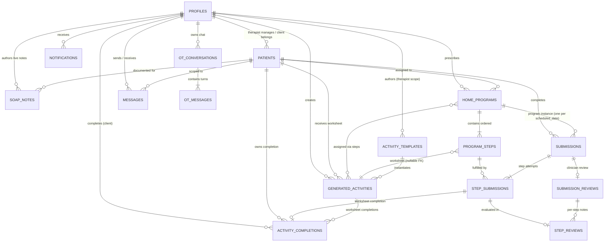

# Aruga Relational Database Design & Architecture
**Document Version:** 3.0  
**Updated:** 2026-11-01 (therapist UI mobile-responsive)  
**Schema Definition:** PostgreSQL 15+ with Row-Level Security (RLS)  
**Source of Truth:** `supabase/all_in_one_setup.sql` (canonical consolidated script) — incremental `supabase/migrations/*.sql` retained for existing DBs

---

## 1. Architectural Overview

Aruga's data architecture enforces a strict **clinician-directed medical paradigm**. The database balances HIPAA-compliant access controls, relational integrity for multi-step rehabilitation home programs + up to 10 scheduled practice dates, high-resolution video/photo storage metadata, two-way clinician-patient linking handshakes, seamless care transfers, clinical SOAP documentation, and Muse Spark + Muse Image worksheet activities with interactive canvas/photo completions.

### Core Architecture Tenets:
1. **Zero-Trust Clinical Governance**: Clients can only view exercise programs explicitly assigned to them, and feedback is strictly concealed while in `draft` state until atomically published by a licensed therapist.
2. **Multi-Box SOAP Clinical Partitioning**: Clinical records are segmented into Subjective, Objective, Assessment, and Plan fields, alongside plain-English family summaries cached for zero-credit client viewing. Both `soap_notes` and `submission_reviews` carry optional `session_recording_url` + `assessment_links` (JSONB).
3. **Caseload Portability & Care Continuity**: Patients can be transferred between therapists while maintaining a cryptographic audit trail (`previous_therapist_id` and `handover_notes`).
4. **Credential Privacy Lifecycle**: Temporary passwords generated during therapist client onboarding are permanently wiped from the database (`NULL`) upon the client's initial login; UI badge shows `Active` once cleared.
5. **Activity Worksheets (Muse Spark + Muse Image)**: 20 system `activity_templates` (5 per age band) seed the library; `generated_activities` persist therapist-tuned prompts + model outputs (base image / PDF); `program_steps.generated_activity_id` attaches a worksheet to a step; `activity_completions` capture interactive canvas (`drawing_data_url` + `drawing_strokes` JSONB) or photo fallback per `step_submission` (unique on `step_submission_id`).
6. **Scheduled Practice Dates**: Each `home_programs.scheduled_dates` (JSONB, ≤10) spawns one `submissions.scheduled_date` per date; strict `program_id` unique dropped in favor of `idx_submissions_prog_date`.

---

## 2. Entity-Relationship (ER) Diagram



---

## 3. Relational Schema & Table Specifications

### 3.1 `public.profiles`
Stores extended user profile metadata for both clinicians and clients, mirroring `auth.users(id)`.

| Column | Type | Constraints | Description |
| :--- | :--- | :--- | :--- |
| `id` | `UUID` | `PK`, `REFERENCES auth.users(id) ON DELETE CASCADE` | Unique user identity matching auth provider |
| `role` | `TEXT` | `NOT NULL`, `CHECK (role IN ('therapist', 'client'))` | Platform access privilege |
| `display_name` | `TEXT` | `NOT NULL` | Display name for user |
| `discipline` | `TEXT` | `CHECK (discipline IN ('SLP','OT','PT') OR NULL)` | OT/PT/SLP (clinician) |
| `client_category` | `TEXT` | `CHECK (client_category IN ('adult','adolescent','pedia','geriatric','old_people') OR NULL)` | Demographic band (legacy `old_people` backfilled to `geriatric`) |
| `email` | `TEXT` | `DEFAULT NULL` | Searchable contact and handshake email |
| `license_number` | `TEXT` | `DEFAULT NULL` | Professional medical license ID |
| `facility_name` | `TEXT` | `DEFAULT NULL` | Practice facility or hospital department |
| `specialties` | `TEXT` | `DEFAULT NULL` | Clinical specialties (e.g. Neuro, Pediatrics, Hand) |
| `phone` | `TEXT` | `DEFAULT NULL` | Office telephone or clinic contact |
| `office_hours` | `TEXT` | `DEFAULT NULL` | Consultation and telemetry hours |
| `caseload_focus` | `TEXT` | `DEFAULT NULL` | Caseload focus area |
| `bio` | `TEXT` | `DEFAULT NULL` | Clinician bio and care philosophy |
| `age` | `INTEGER` | `DEFAULT NULL` | Client age |
| `date_of_birth` | `TEXT` | `DEFAULT NULL` | Client DOB for age demographic classification |
| `primary_condition` | `TEXT` | `DEFAULT NULL` | Medical diagnosis |
| `caregiver_name` | `TEXT` | `DEFAULT NULL` | Co-runner / parent name for pediatric & geriatric cases |
| `caregiver_relationship` | `TEXT` | `DEFAULT NULL` | Caregiver relationship |
| `emergency_phone` | `TEXT` | `DEFAULT NULL` | Emergency contact |
| `therapy_goals` | `TEXT` | `DEFAULT NULL` | Client rehabilitation goals |
| `preferred_schedule` | `TEXT` | `DEFAULT NULL` | Preferred schedule notes |
| `sensory_preferences` | `TEXT` | `DEFAULT NULL` | Sensory preferences |
| `school_or_workplace` | `TEXT` | `DEFAULT NULL` | School/workplace |
| `created_at` | `TIMESTAMPTZ`| `DEFAULT now()` | Record creation timestamp |
| `updated_at` | `TIMESTAMPTZ`| `DEFAULT now()` | Record last modification timestamp |

---

### 3.2 `public.patients`
Represents the therapeutic caseload linkage between a therapist and a client.

| Column | Type | Constraints | Description |
| :--- | :--- | :--- | :--- |
| `id` | `UUID` | `PK DEFAULT gen_random_uuid()` | Unique patient record identity |
| `therapist_id` | `UUID` | `REFERENCES public.profiles(id) ON DELETE SET NULL` | Current supervising clinician |
| `client_user_id` | `UUID` | `REFERENCES public.profiles(id) ON DELETE SET NULL` | Linked client auth ID (nullable for unclaimed records) |
| `name` | `VARCHAR(150)` | `NOT NULL` | Patient name |
| `age` | `INTEGER` | `NOT NULL DEFAULT 1` | Age |
| `gender` | `VARCHAR(50)` | `NOT NULL DEFAULT 'Unspecified'` | Gender |
| `condition` | `VARCHAR(255)` | `NOT NULL` | Diagnosis / clinical presentation |
| `email` | `VARCHAR(255)` | `NOT NULL UNIQUE` | Patient email used for invitations and account matching |
| `caregiver_name` | `TEXT` | `DEFAULT NULL` | Caregiver co-runner name |
| `client_category` | `TEXT` | `CHECK (client_category IN ('adult','adolescent','pedia','geriatric','old_people') OR NULL)` | Demographic categorization |
| `invitation_status`| `TEXT` | `DEFAULT 'accepted' CHECK (invitation_status IN ('pending','accepted','declined','unlinked'))` | Two-way handshake state |
| `invitation_initiated_by` | `TEXT` | `DEFAULT 'therapist' CHECK (invitation_initiated_by IN ('therapist','client') OR NULL)` | Initiator of linkage |
| `invitation_sent_at` | `TIMESTAMPTZ` | `DEFAULT NOW()` | Invite timestamp |
| `pending_therapist_email` | `TEXT` | `DEFAULT NULL` | Pending therapist email (pre-link) |
| `previous_therapist_id` | `UUID` | `REFERENCES public.profiles(id)` | Care transfer source clinician |
| `handover_notes` | `TEXT` | `DEFAULT NULL` | Clinical summary transferred during handover |
| `temporary_password` | `TEXT` | `DEFAULT NULL` | Temp bootstrap secret; nulled on first login (therapist-only visibility) |
| `first_login_at` | `TIMESTAMPTZ` | `DEFAULT NULL` | First client login timestamp |
| `credentials_cleared_at` | `TIMESTAMPTZ` | `DEFAULT NULL` | Credential wipe timestamp |
| `created_at` | `TIMESTAMPTZ`| `DEFAULT now()` | Linkage creation timestamp |
| `updated_at` | `TIMESTAMPTZ`| `DEFAULT now()` | Linkage update timestamp |

Indexes: `idx_patients_therapist`, `idx_patients_pending_therapist_email`, `idx_patients_invitation_status`, `uq_patients_client_user_idx` (WHERE NOT NULL), `uq_patients_email_idx`.

---

### 3.3 `public.soap_notes`
Multi-box clinical notes authored during or after live in-person or telehealth sessions (UI label: **Session Clinical Documentation**).

| Column | Type | Constraints | Description |
| :--- | :--- | :--- | :--- |
| `id` | `UUID` | `PK DEFAULT gen_random_uuid()` | Unique session note ID |
| `patient_id` | `UUID` | `NOT NULL REFERENCES public.patients(id) ON DELETE CASCADE` | Associated patient record |
| `therapist_id` | `UUID` | `NOT NULL REFERENCES public.profiles(id) ON DELETE CASCADE` | Authoring clinician |
| `session_date` | `TIMESTAMPTZ`| `DEFAULT now()` | Date and time session occurred |
| `session_title` | `TEXT` | `NOT NULL DEFAULT 'Live Therapy Session'` | Session descriptor |
| `session_recording_url` | `TEXT` | `DEFAULT NULL` | Optional session recording URL (`00008`) |
| `subjective` | `TEXT` | `NOT NULL DEFAULT ''` | **S**: Patient quotes, fatigue, comfort, pain levels |
| `objective` | `TEXT` | `NOT NULL DEFAULT ''` | **O**: Measured ROM, grip force, reps, completion metrics |
| `assessment` | `TEXT` | `NOT NULL DEFAULT ''` | **A**: Neuromuscular progression, compensatory patterns |
| `assessment_links` | `JSONB` | `DEFAULT '[]'::jsonb` | Optional assessment resource links (`00008`) |
| `plan` | `TEXT` | `NOT NULL DEFAULT ''` | **P**: Next steps, home program modifications, assigned drills |
| `client_summary`| `TEXT` | `NOT NULL DEFAULT ''` | Plain-English summary for patient & family (DB-cached) |
| `created_at` | `TIMESTAMPTZ`| `DEFAULT now()` | Creation timestamp |
| `updated_at` | `TIMESTAMPTZ`| `DEFAULT now()` | Modification timestamp |

Indexes: `idx_soap_notes_patient_id`, `idx_soap_notes_session_date DESC`.

---

### 3.4 `public.home_programs` & `public.program_steps`
Prescribed rehabilitation home programs and their atomic exercise steps.

#### `home_programs`:
- `id` (`UUID PK`)
- `patient_id` (`UUID NOT NULL REFERENCES patients(id) ON DELETE CASCADE`)
- `creator_id` (`UUID REFERENCES profiles(id) ON DELETE SET NULL`)
- `title` (`VARCHAR(200) NOT NULL`)
- `main_instructions` (`TEXT NOT NULL`)
- `scheduled_dates` (`JSONB DEFAULT '[]'::jsonb`) — up to 10 ISO dates; drives one `submissions.scheduled_date` per date (`00009`, consolidated into `all_in_one_setup.sql`)
- `status` (`TEXT DEFAULT 'assigned' CHECK (status IN ('draft', 'assigned', 'archived'))`)
- `assigned_at` (`TIMESTAMPTZ DEFAULT NOW()`)
- `created_at`, `updated_at` (`TIMESTAMPTZ`)

#### `program_steps`:
- `id` (`UUID PK`)
- `program_id` (`UUID NOT NULL REFERENCES home_programs(id) ON DELETE CASCADE`)
- `position` (`INT NOT NULL DEFAULT 1`)
- `title` (`VARCHAR(150) DEFAULT NULL`)
- `instructions` (`TEXT NOT NULL`)
- `generated_activity_id` (`UUID REFERENCES generated_activities(id) ON DELETE SET NULL`) — nullable worksheet attachment (`05` + `00009` index)
- `created_at` (`TIMESTAMPTZ`)

Constraints: `uq_program_step_position UNIQUE (program_id, position)`. Indexes: `idx_program_steps_program`, `idx_program_steps_generated_activity`, `idx_submissions_prog_date (program_id, scheduled_date)`.

---

### 3.5 `public.submissions` & `public.step_submissions`
Captures client performance, recorded video/photo evidence, and skip rationales.

#### `submissions`:
- `id` (`UUID PK`)
- `program_id` (`UUID NOT NULL REFERENCES home_programs(id) ON DELETE CASCADE`)
- `patient_id` (`UUID NOT NULL REFERENCES public.patients(id) ON DELETE CASCADE`)
- `client_id` (`UUID REFERENCES public.profiles(id) ON DELETE SET NULL`)
- `scheduled_date` (`TEXT DEFAULT NULL`) — ISO date string matching one entry in `home_programs.scheduled_dates` (`00009`)
- `state` (`TEXT NOT NULL DEFAULT 'submitted' CHECK (state IN ('draft','submitted','reviewed'))`)
- `consent_therapist` (`BOOLEAN NOT NULL DEFAULT true`)
- `consent_meta_ai` (`BOOLEAN NOT NULL DEFAULT true`)
- `submitted_at` (`TIMESTAMPTZ DEFAULT NOW()`)
- `reviewed_at` (`TIMESTAMPTZ DEFAULT NULL`)
- `created_at`, `updated_at` (`TIMESTAMPTZ`)

> Strict `program_id` unique was dropped in `00009`; uniqueness is now `(program_id, scheduled_date)` via `idx_submissions_prog_date` to allow one submission per scheduled practice date.

#### `step_submissions`:
- `id` (`UUID PK`)
- `submission_id` (`UUID NOT NULL REFERENCES submissions(id) ON DELETE CASCADE`)
- `program_step_id` (`UUID NOT NULL REFERENCES program_steps(id) ON DELETE CASCADE`)
- `video_path` (`TEXT DEFAULT NULL`) — generic media path (photo OR video) in `program-videos` bucket; typed via `media_meta.mime` (`00013`)
- `media_meta` (`JSONB NOT NULL DEFAULT '{}'::jsonb`) — `{ mime, sizeBytes, durationSeconds?, width?, height?, storagePath, bucket, uploadedAt, mediaKind: "photo"|"video" }`
- `client_comment` (`TEXT DEFAULT NULL`)
- `skipped` (`BOOLEAN NOT NULL DEFAULT FALSE`)
- `skip_reason` (`TEXT DEFAULT NULL`) — mandatory if `skipped = true`
- `created_at`, `updated_at` (`TIMESTAMPTZ`)
- Constraint: `uq_step_submission UNIQUE (submission_id, program_step_id)`

RPC `submit_program_steps(p_submission_id UUID)` (`00013`) enforces: each step has `media (video_path)` OR `skipped+skip_reason`; then flips `submissions.state='submitted'` and inserts a `draft` `submission_reviews` row.

---

### 3.6 `public.submission_reviews` & `public.step_reviews`
Clinician evaluation and feedback records.

#### `submission_reviews`:
- `id` (`UUID PK`)
- `submission_id` (`UUID UNIQUE NOT NULL REFERENCES submissions(id) ON DELETE CASCADE`)
- `therapist_id` (`UUID REFERENCES profiles(id) ON DELETE SET NULL`)
- `overall_feedback` (`TEXT DEFAULT NULL`) — synthesized clinician commentary (nullable in consolidated schema; legacy SOAP `subjective/objective/assessment/plan/client_summary` columns live on `soap_notes`; parity fields added below)
- `session_recording_url` (`TEXT DEFAULT NULL`) — optional recording (`00012`)
- `assessment_links` (`JSONB DEFAULT '[]'::jsonb`) — optional links (`00012`)
- `status` (`TEXT NOT NULL DEFAULT 'published' CHECK (status IN ('draft','published'))`)
- `published_at` (`TIMESTAMPTZ DEFAULT NOW()`)
- `created_at`, `updated_at` (`TIMESTAMPTZ`)

#### `step_reviews`:
- `id` (`UUID PK`)
- `review_id` (`UUID NOT NULL REFERENCES submission_reviews(id) ON DELETE CASCADE`)
- `step_submission_id` (`UUID NOT NULL REFERENCES step_submissions(id) ON DELETE CASCADE`)
- `therapist_note` (`TEXT NOT NULL DEFAULT ''`)
- `created_at`, `updated_at` (`TIMESTAMPTZ`)
- Constraint: `uq_step_review UNIQUE (review_id, step_submission_id)`

---

### 3.7 `public.activity_templates`, `public.generated_activities`, `public.activity_completions`
Activity Studio — Muse Spark + Muse Image worksheets (consolidated in `all_in_one_setup.sql` §§ 05–06; 20 system seeds).

#### `activity_templates` (system presets + therapist saved prompts):
- `id` (`UUID PK`)
- `therapist_id` (`UUID REFERENCES profiles(id) ON DELETE CASCADE`) — NULL for `system`, set for `therapist` scope
- `owner_scope` (`TEXT NOT NULL DEFAULT 'system' CHECK (owner_scope IN ('system','therapist'))`)
- `title` (`TEXT NOT NULL`), `description` (`TEXT`), `is_featured` (`BOOLEAN NOT NULL DEFAULT false`)
- `age_band` (`TEXT NOT NULL CHECK (age_band IN ('pedia','adolescent','adult','geriatric'))`)
- `category` (`TEXT NOT NULL CHECK (category IN ('coloring','handwriting','tracing','maze','matching','cognitive','adl_sim','visual_motor','fine_motor','other'))`) — `fine_motor` self-healed at deploy time
- `spark_prompt` (`TEXT NOT NULL`), `image_prompt` (`TEXT NOT NULL`), `default_params` (`JSONB NOT NULL DEFAULT '{}'`), `thumbnail_path` (`TEXT`)
- `created_at`, `updated_at` (`TIMESTAMPTZ`)
- Unique: `uq_activity_template_system_title ON (owner_scope, title) WHERE owner_scope='system'`
- Indexes: `idx_activity_templates_age_band|category|therapist|owner_scope`

#### `generated_activities` (worksheet artifacts):
- `id` (`UUID PK`)
- `creator_id` (`UUID REFERENCES profiles(id)`) — therapist who generated
- `patient_id` (`UUID REFERENCES patients(id) ON DELETE SET NULL`) — assigned client (nullable for library-only)
- `template_id` (`UUID REFERENCES activity_templates(id) ON DELETE SET NULL`)
- `age_band` (`TEXT NOT NULL CHECK (age_band IN ('pedia','adolescent','adult','geriatric'))`)
- `title` (`TEXT NOT NULL`), `instructions` (`TEXT NOT NULL`)
- `spark_prompt_used` (`TEXT NOT NULL DEFAULT ''`), `image_prompt_used` (`TEXT NOT NULL DEFAULT ''`), `reference_links` (`TEXT[] NOT NULL DEFAULT '{}'`), `reference_image_paths` (`TEXT[] NOT NULL DEFAULT '{}'`)
- `spark_spec` (`JSONB`), `base_image_path`/`base_image_url` (`TEXT`), `composed_pdf_path` (`TEXT`), `model_ids` (`JSONB NOT NULL DEFAULT '{}'`)
- `status` (`TEXT NOT NULL DEFAULT 'ready' CHECK (status IN ('generating','ready','failed'))`), `error_message` (`TEXT`)
- `created_at`, `updated_at` (`TIMESTAMPTZ`)
- Indexes: `idx_generated_activities_creator|patient|template|age_band|created`

#### `activity_completions` (client work product):
- `id` (`UUID PK`)
- `generated_activity_id` (`UUID NOT NULL REFERENCES generated_activities(id) ON DELETE CASCADE`)
- `step_submission_id` (`UUID REFERENCES step_submissions(id) ON DELETE CASCADE`) — nullable when completed outside a program step
- `patient_id` (`UUID NOT NULL REFERENCES patients(id) ON DELETE CASCADE`), `client_id` (`UUID REFERENCES profiles(id) ON DELETE SET NULL`)
- `drawing_data_url` (`TEXT`), `drawing_storage_path` (`TEXT`), `drawing_strokes` (`JSONB NOT NULL DEFAULT '[]'::jsonb`) — interactive canvas (destination-out eraser, 12 crayons)
- `photo_upload_path` (`TEXT`) — photo fallback
- `completion_method` (`TEXT NOT NULL DEFAULT 'canvas' CHECK (completion_method IN ('canvas','photo','print_upload'))`), `completed_at` (`TIMESTAMPTZ`), `created_at`, `updated_at` (`TIMESTAMPTZ`)
- Unique: `uq_activity_completion_step_sub ON (step_submission_id) WHERE step_submission_id IS NOT NULL` — one completion per step submission
- Indexes: `idx_activity_completions_generated|patient|step_sub`
- App-level: 5MB cap enforced on payload; API persists `base_image_url null` path for text-only (`generateImage=false`) generations

Seed: `06: SEED 20 ACTIVITY TEMPLATES` deletes and re-inserts all `owner_scope='system'` rows (5 per band: pedia 2–12 bold outlines, adolescent 13–17 graffiti/planner/anatomy/maze/emotions, adult 18–64 cursive/ADL/keyboard/geometry/budget, geriatric 65+ large-print/flower/dot-to-dot/medication/reminiscence), each with `spark_prompt` + `image_prompt` + `default_params` (`difficulty/theme/orientation/estimatedMinutes`).

---

### 3.8 `public.messages` & `public.notifications` patterns

#### `messages` (therapist↔client 1-on-1):
- `id` (`UUID PK`)
- `patient_id` (`UUID NOT NULL REFERENCES public.patients(id) ON DELETE CASCADE`)
- `sender_id` (`UUID REFERENCES public.profiles(id) ON DELETE SET NULL`)
- `body` (`TEXT NOT NULL CHECK (LENGTH(body) BETWEEN 1 AND 4000)`)
- `referenced_program_id` (`UUID REFERENCES home_programs(id) ON DELETE SET NULL`) — `@program` mention chip target
- `created_at` (`TIMESTAMPTZ`)
- RPC: `send_chat_message_deduped(p_patient_id, p_sender_id, p_body, p_referenced_program_id)` — 3-second dedup window

> `notifications` are delivered via application layer (bell dropdown) using `profiles`/`patients`/`home_programs`/`messages` state; persisted in app cache rather than a dedicated table in this schema.

---

### 3.9 Support tables (`ai_analyses`, `audit_events`, `sam_test_results`, `ot_conversations`)

- **`ai_analyses`**: per-`step_submission` Spark/SAM results (`spark_results`/`sam_results` JSONB, `artifact_path`, `timing_ms`, `confirmed_observations`); `uq_ai_analyses_step UNIQUE (step_submission_id)`
- **`audit_events`**: `actor_id`, `action`, `affected_resource`, `resource_id`, `metadata` JSONB; immutable via `prevent_audit_tampering()` trigger (`00011`); indexes `idx_audit_events_created_at|action|actor_time`
- **`sam_test_results`**: `user_id`, `prompt`, `file_name`, `duration_seconds`, `object_concepts|tracks|boxes|svg_paths` JSONB, `billed_requests`, `model_id`, `latency_ms`
- **`ot_conversations`/`ot_messages`**: Ask OT (now **Aruga Guide** at `/aruga-guide` with permanent redirect from `/ask-ot`) — `user_id`, `title`, `model_id`; `conversation_id`, `role ∈ {user,assistant}`, `content`, `attachments` JSONB, `sam_result` JSONB

---

## 4. Cloud Storage Architecture

Three private buckets (all `public=false`; `TO authenticated` storage policies):

| Bucket | Size limit | MIME types | Purpose |
|---|---|---|---|
| `program-videos` | 100 MB | `video/mp4, video/webm, video/quicktime, image/jpeg, image/png, image/webp, image/heic` (`00013` added image types) | Client photo/video per-step uploads (`step_submissions.video_path` + `media_meta`) + signed URLs (15m video / 60m chat), `nanoid(12)` random prefix, EXIF stripped via `sharp.rotate().withMetadata({})` |
| `chat-attachments` | 50 MB | `image/jpeg, image/png, image/webp, video/mp4, video/webm` | `@program` mention attachments |
| `activity-assets` | 20 MB | `image/png, image/jpeg, image/webp, image/svg+xml, application/pdf` | `generated_activities.base_image_path` + `composed_pdf_path` + `activity_completions.drawing_storage_path`/`photo_upload_path` |

**Path convention:**
```text
program-videos/
  {patient_id}/
    {submission_id}/
      step_{step_id}_{timestamp}_{nanoid}.mp4|jpg

activity-assets/
  activities/{generated_activity_id}/base.{png|jpg}
  activities/{generated_activity_id}/composed.pdf
  completions/{activity_completion_id}/drawing.png
```

**Access Policies (storage.objects, `all_in_one_setup.sql` + `00013`):**
```sql
-- Read: authenticated only, per-bucket
CREATE POLICY "Authenticated view for program media" ON storage.objects FOR SELECT TO authenticated
  USING (bucket_id IN ('program-videos','chat-attachments'));
CREATE POLICY "Authenticated view activity assets"   ON storage.objects FOR SELECT TO authenticated
  USING (bucket_id = 'activity-assets');

-- Insert / Update / Delete: authenticated (update+delete added in 00013 for retry/replace)
CREATE POLICY "Authenticated upload for program videos" ON storage.objects FOR INSERT  TO authenticated WITH CHECK  (bucket_id IN ('program-videos','chat-attachments'));
CREATE POLICY "Authenticated update for program-videos" ON storage.objects FOR UPDATE TO authenticated USING (bucket_id='program-videos') WITH CHECK (bucket_id='program-videos');
CREATE POLICY "Authenticated delete for program-videos" ON storage.objects FOR DELETE TO authenticated USING (bucket_id='program-videos');

-- Service role retains FULL ALL; no public/anon read.
```

HIPAA hardening of `program-videos` to `public=false` + `TO authenticated` is enforced in `00011` (and re-applied in `00013`); `00013 public=false` is the final truth — verified by `scripts/verify-rls.sql`.

---

## 5. Security & Row-Level Security (RLS) Policies

All tables enforce RLS. Primary rules include:

1. **Patient Data Isolation**:
   ```sql
   CREATE POLICY "Therapists manage own patients" ON public.patients
     FOR ALL USING (therapist_id = auth.uid()) WITH CHECK (therapist_id = auth.uid());
   CREATE POLICY "Clients view own patient record" ON public.patients
     FOR SELECT USING (client_user_id = auth.uid());
   ```

2. **Draft Feedback Concealment**:
   ```sql
   CREATE POLICY "Therapists manage reviews" ON public.submission_reviews
     FOR ALL USING (therapist_id = auth.uid()) WITH CHECK (therapist_id = auth.uid());
   CREATE POLICY "Clients view published reviews" ON public.submission_reviews
     FOR SELECT USING (status='published' AND EXISTS (
       SELECT 1 FROM public.submissions s WHERE s.id = submission_reviews.submission_id AND s.client_id = auth.uid()
     ));
   ```

3. **SOAP Notes (Session Clinical Documentation)**:
   ```sql
   ALTER TABLE public.soap_notes ENABLE ROW LEVEL SECURITY;
   -- Therapists manage own caseload notes; clients read their own patient notes
   -- Actual policies use therapist_owns_patient(patient_id) + client_user_id match
   ```

4. **Activities**:
   ```sql
   -- Templates: system visible to all authed, therapist scope owner-only
   CREATE POLICY "Authenticated view system templates" ON public.activity_templates FOR SELECT TO authenticated
     USING (owner_scope='system' OR therapist_id=auth.uid());
   CREATE POLICY "Therapists manage own templates" ON public.activity_templates FOR ALL TO authenticated
     USING (therapist_id=auth.uid() OR owner_scope='system')
     WITH CHECK ((owner_scope='therapist' AND therapist_id=auth.uid()) OR owner_scope='system');

   -- Generated activities: creator + assigned patient participants can view
   CREATE POLICY "Therapists manage generated activities" ON public.generated_activities FOR ALL TO authenticated
     USING (creator_id=auth.uid() OR EXISTS(SELECT 1 FROM public.patients WHERE id=generated_activities.patient_id AND client_user_id=auth.uid())
           OR EXISTS(SELECT 1 FROM public.patients WHERE id=generated_activities.patient_id AND therapist_id=auth.uid()))
     WITH CHECK (creator_id=auth.uid());

   -- Completions: therapist owns patient OR client owns row
   CREATE POLICY "Therapists view completions" ON public.activity_completions FOR SELECT TO authenticated
     USING (public.therapist_owns_patient(patient_id) OR client_id=auth.uid());
   CREATE POLICY "Clients manage own completions" ON public.activity_completions FOR ALL TO authenticated
     USING (client_id=auth.uid() OR public.therapist_owns_patient(patient_id))
     WITH CHECK (client_id=auth.uid());
   ```

5. **Audit Immutability (`00011`)**:
   ```sql
   CREATE OR REPLACE FUNCTION public.prevent_audit_tampering() RETURNS TRIGGER AS $$
   BEGIN RAISE EXCEPTION 'HIPAA Compliance Violation: Audit logs are immutable...'; END; $$ LANGUAGE plpgsql;
   CREATE TRIGGER trg_prevent_audit_update BEFORE UPDATE ON public.audit_events FOR EACH ROW EXECUTE FUNCTION public.prevent_audit_tampering();
   CREATE TRIGGER trg_prevent_audit_delete BEFORE DELETE ON public.audit_events FOR EACH ROW EXECUTE FUNCTION public.prevent_audit_tampering();
   ```

Helper: `public.therapist_owns_patient(p_patient_id UUID)` → `EXISTS (SELECT 1 FROM public.patients WHERE id=p_patient_id AND therapist_id=auth.uid())` used across program/step/submission/message/ai_analyses policies.

---

## 6. Migration Registry & `all_in_one_setup.sql` Mapping

Canonical deploy: run `all_in_one_setup.sql` (idempotent via `IF NOT EXISTS`/`ON CONFLICT`/DO blocks). Incrementals below mirror the same changes for existing DBs:

| # | Migration File | Key Tables / Operations | Consolidated in `all_in_one_setup.sql`? |
| :--- | :--- | :--- | :--- |
| `—` | `all_in_one_setup.sql` | Baseline schema + RLS + triggers + RPCs + 3 private buckets + `soap_notes` + §§ **05–06** activity tables + **20-template seeds** + demo data | **Yes — source of truth** |
| `01` | `20261030000001_add_old_people_category.sql` | Adds `'old_people'` to `patients.client_category` enum | ✅ |
| `02` | `20261031000001_link_therapist_in_new_user_trigger.sql` | Auto-links client auth accounts to existing patient records by email | ✅ |
| `03` | `20261031000002_two_way_handshake_invitations.sql` | Adds `invitation_status` & `invitation_initiated_by` to `patients` | ✅ |
| `04` | `20261031000003_care_transfer_service.sql` | Adds `previous_therapist_id` & `handover_notes` for clinician caseload transfers | ✅ |
| `05` | `20261031000004_program_videos_storage.sql` | Sets up private `program-videos` + `chat-attachments` buckets | ✅ (unified) |
| `06` | `20261031000005_pending_requests_and_profiles_email.sql` | Adds `email` to `profiles`, indexing for pending handshake queries | ✅ |
| `07` | `20261031000006_soap_notes_and_program_feedback.sql` | Creates `soap_notes` table and adds SOAP fields to `submission_reviews` | ✅ |
| `08` | `20261031000007_ensure_therapist_created_user_is_client_type.sql` | Enforces therapist-created/linked users strictly `role='client'` | ✅ |
| `09` | `20261031000008_soap_recording_and_assessment_links.sql` | `soap_notes.session_recording_url` + `assessment_links` JSONB | ✅ |
| `10` | `20261031000009_home_program_scheduled_dates_and_submission_edits.sql` | `home_programs.scheduled_dates` JSONB + `submissions.scheduled_date` TEXT, drops strict program→submission unique → `idx_submissions_prog_date` | ✅ |
| `11` | `20261031000010_update_geriatric_category.sql` | Expands `client_category` to `geriatric|old_people`, backfills `old_people→geriatric` | ✅ |
| `12` | `20261031000011_hipaa_security_safeguards.sql` | `program-videos public=false` + `TO authenticated` select, `prevent_audit_tampering()` triggers, audit indexes | ✅ (final form in `00013`) |
| `13` | `20261031000012_submission_reviews_soap_recording_and_assessments.sql` | `submission_reviews.session_recording_url` + `assessment_links` JSONB | ✅ |
| `14` | `20261031000013_photo_upload_support.sql` | `program-videos` image MIMEs, `authenticated update/delete` policies, `submit_program_steps` media-or-skip RPC, `video_path`/`media_meta` comments | ✅ (`program-videos` hardening is final truth) |

> `RUN_ONCE_PRIVACY_FIX.sql` / `RUN_ONCE_AUTO_LINK_ON_FIRST_LOGIN.sql` / `RUN_ONCE_PRIVACY_FIX_C3_DROP_OPEN_POLICIES.sql` remain applied post-`all_in_one_setup.sql` on fresh installs (auto-accept therapist pendings + drop legacy permissive policies). Verify storage `public=false` + RLS via `scripts/verify-rls.sql`.

## 7. Notable Design Decisions

- **Scheduled dates as JSONB** (`home_programs.scheduled_dates`) rather than a join table — keeps assignment atomic (≤10 dates) and allows the program editor to swap dates without FK cascades; submissions index on `(program_id, scheduled_date)` suffices for lookups.
- **Generic `video_path` + `media_meta`** on `step_submissions` — backward-compatible column name retained; MIME-typed via JSONB so the same RPC serves photo and video without schema break.
- **`activity_completions` side table** — decouples worksheet interactivity (canvas strokes / photo) from `step_submissions` upload plumbing; unique on `step_submission_id` prevents duplicate completions per step.
- **`all_in_one_setup.sql` as deploy truth** — avoids migration-order drift (activity templates + program-videos photo support + geriatric backfill all self-heal on re-run); incrementals exist only for already-deployed DBs.
- **Private storage with `TO authenticated`** — `program-videos:public=false` regression (Finding 3) is fixed in `20261031000013`; `activity-assets` follows same pattern.
